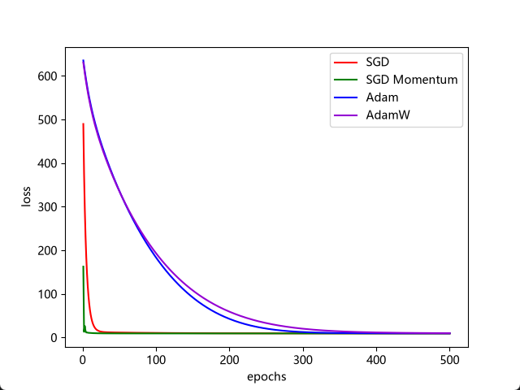

# 优化器
在机器学习中，我们通常需要定义一个损失函数（Loss Function），用于衡量模型预测值与真实值之间的差异。
训练模型的目标之一，就是不断调整模型参数，使损失函数的值尽可能小。
而优化器（Optimizer）的作用，就是根据梯度等信息更新模型参数，让模型逐步降低损失。
不同优化器采用的参数更新策略有所不同，例如 SGD、Momentum、Adagrad、RMSprop、Adam 和 AdamW。
由于这些优化器大多涉及梯度计算和数学公式，而我目前对导数的理解还比较有限，因此暂时不深入研究数学推导，而是先通过 PyTorch 的代码和实验来理解它们的基本原理和工作过程。
---
#### 梯度下降算法
梯度下降（Gradient Descent）是一种利用损失函数的梯度来更新模型参数，从而逐步降低损失的优化算法。
可以把梯度下降想象成下山：假设我们站在山坡上的某个位置，根据当前位置的坡度判断下降方向，而学习率（Learning Rate）则控制每一步移动的幅度。
学习率太小，可能下山很慢；学习率太大，则可能跨过山谷最低点，甚至来回震荡。
此外，梯度下降也可能在局部最低点附近停滞，或者在狭窄的山谷中反复震荡，影响收敛速度。

梯度下降法按照每次参数更新使用的样本数量，可以分为三种形式：
- BGD（Batch Gradient Descent）：批量梯度下降，每次参数更新使用整个训练集。 https://zhuanlan.zhihu.com/p/357963858
- SGD（Stochastic Gradient Descent）：随机梯度下降，每次参数更新使用一个随机样本。https://zhuanlan.zhihu.com/p/357963858
- MBGD（Mini-Batch Gradient Descent）：小批量梯度下降，每次参数更新使用一小批样本。https://zhuanlan.zhihu.com/p/357963858
在 PyTorch 中，这三种方式都可以使用 torch.optim.SGD 实现。区别主要在于每次计算梯度所使用的数据量，可以通过 DataLoader 的 batch_size 和训练循环进行控制。


前面介绍了按照样本数量划分的三种梯度下降方式。接下来，我们看看其他常见的优化算法，以及它们如何利用梯度信息更新模型参数。

#### 动量梯度下降（Momentum Gradient Descent）
https://zhuanlan.zhihu.com/p/672686782
动量梯度下降在普通梯度下降的基础上引入了动量（Momentum），使参数更新具有类似惯性的效果。

它可以在持续下降的方向上加快更新，并减少某些方向上的震荡，从而在一些情况下加快收敛。

此外，动量也可能帮助参数穿过一些较浅的局部最小值，但不能保证跳出所有局部最小值。

在许多机器学习问题中，损失函数可能存在多个局部最小值，此外还可能存在鞍点等驻点。
传统梯度下降通过不断更新参数来降低损失函数的值，但不保证一定能够找到全局最优解。
对于复杂的非凸优化问题，梯度下降可能收敛到局部最小值，也可能在某些区域停滞。

> 鞍点（Saddle Point）
>
> 「鞍点」是机器学习优化过程中的一类特殊点，其梯度为 0，但既不是局部极大值点，也不是局部极小值点。

- 对于普通梯度下降，当梯度为 0 时，参数更新可能停止。而动量机制利用历史梯度信息，有时能够帮助参数继续移动。
- **不同方向的梯度差异较大**：当损失函数在某些方向上变化剧烈，而在其他方向上变化平缓时，梯度下降可能在陡峭方向上反复震荡，导致收敛速度变慢。

----

#### Adagrad 优化算法
https://zhuanlan.zhihu.com/p/29920135
AdaGrad（Adaptive Gradient）是一种自适应学习率优化算法。
它会根据不同参数的历史梯度信息，分别调整各参数的有效学习率，从而在一定程度上减少更新幅度过大带来的震荡。
AdaGrad 和普通 SGD 的核心区别，就是它会为每个参数动态调整有效学习率。
不过，由于 AdaGrad 会不断累积历史梯度的平方，各参数的有效学习率可能持续减小，导致训练后期参数更新缓慢，甚至难以继续有效优化。

> 全局学习率是传给优化器的lr参数
> 
> 有效学习率 是优化器自己调整的学习率。

#### RMSProp 均方根传播
https://blog.csdn.net/m0_48923489/article/details/136863547

RMSprop（Root Mean Square Propagation）是一种自适应学习率优化算法。它通过对梯度平方进行指数移动平均，动态调整各参数的有效学习率，缓解 AdaGrad 因历史梯度不断累积而导致有效学习率持续减小的问题。

RMSprop 可以用于非凸优化和大规模深度学习任务，但训练效果受到学习率、衰减系数等超参数的影响，并不保证在所有任务中都优于其他优化器。


## Adam
https://blog.csdn.net/DeepModel/article/details/159939231

Adam 自适应矩估计
Adam（Adaptive Moment Estimation）是在梯度下降（Gradient Descent）思想基础上发展而来的一种优化算法，也是深度学习中最受欢迎的优化器之一。
它结合了 Momentum 和 RMSprop 的思想，既会参考历史梯度的变化趋势，又会根据梯度的历史统计信息自适应地调整参数的更新幅度。

Adam 简直就是深度学习中的万能优化器！ 不仅能够利用历史梯度信息，让参数更新更加稳定，还能自动调整各参数的有效学习率，通常能够获得不错的收敛效果。

Adam 完整流程（7 步）

1. 初始化模型参数 θ，一阶矩 m = 0，二阶矩 v = 0    

2. 计算当前梯度 $g_t$

3. 更新一阶矩估计 $m_t$

4. 更新二阶矩估计 $v_t$

5. 对一阶矩和二阶矩进行偏差校正

6. 使用校正后的矩估计更新模型参数 $θ$

7. 重复上述步骤，直到达到停止条件

Adam 适合哪些场景？
- 深度学习模型：适用于 CNN、RNN、Transformer 等多种神经网络。
- 稀疏梯度任务：例如部分 NLP、推荐系统中的稀疏特征训练。
- 大规模模型训练：可以用于图像、语音、视频等任务，但需要根据模型选择优化器。
- 复杂或不稳定的训练任务：常用于 GAN、强化学习，但不保证训练稳定。
- 快速实验与模型原型验证：Adam 通常是一个方便的起点，可以减少部分超参数调试工作。


除了 Adam，**AdamW 和 Muon 也是两个值得关注的优化器**，它们在优化方式上有着不同的设计思路，值得进一步研究和探索。

# AdamW
https://zhuanlan.zhihu.com/p/643452086
AdamW（Adam with Decoupled Weight Decay）是大语言模型训练中广泛使用的优化器之一，但它并不局限于大语言模型，同样可以用于分类（Classification）和回归（Regression）等任务。
AdamW 的核心改进是**改变了 Adam 中权重衰减（Weight Decay）的处理方式**。

## 为什么要这么改？

我们可以把模型训练简单理解为两件事：
- **优化损失**：通过调整模型参数，使预测结果更接近真实值。
- **权重衰减**：限制权重过大，帮助模型减少过拟合。

传统 Adam 在使用 L2 正则化时，会将正则项加入梯度计算，使其参与一阶矩和二阶矩的估计。

而 AdamW 则将权重衰减与梯度计算分开，在参数更新阶段独立处理，使权重衰减不再影响 Adam 的矩估计。

这就是 **Decoupled Weight Decay（解耦权重衰减）**。

研究表明，AdamW 在不少任务中能够取得比传统 Adam + L2 正则化更好的效果。

例如，线性回归、二分类神经网络和 MNIST 卷积神经网络都可以使用 AdamW 进行训练。


## Muon 优化器
https://github.com/vukrosic/muon-optimizer-guide
Muon 正在受到越来越多研究团队的关注，包括 DeepSeek、OpenAI、Meta、Moonshot AI 等。部分团队已经尝试使用 Muon 替代 AdamW 来训练大语言模型和神经网络。

有 DeepSeek 研究人员将 Muon 评价为 2025 年最重要的两项技术创新之一，另一项则与 Hyper-Connections（超连接）有关。

根据 Muon Optimizer Guide 的介绍，如果你正在训练神经网络，非常值得尝试 Muon。在部分实验中，它可能带来约 30% 到 2 倍的训练效率提升。

PyTorch 2.10 已提供 Muon 的官方实现！

在大语言模型（LLM）训练中，Muon 的目标之一是使用更少的训练 Token 和计算资源，更快地达到相同的 Loss 水平。

当然，Muon 并不一定在所有情况下都是最好的优化器，但它确实值得尝试。

Muon 与 SGD 的不同之处在于：Muon 会先对参数更新矩阵进行特殊处理，再更新权重。

传统优化器可能在某些方向上更新得很强，而在另一些方向上更新得很弱。

Muon 的核心思想是 Orthogonalization（正交化）。

它通过 Newton–Schulz 迭代，近似将更新矩阵的非零奇异值调整到接近 1，使不同方向上的更新更加均衡。

Muon 在部分大模型训练中取得了不错的效果，但它并不适合直接替换所有优化器，通常还需要与 AdamW 等优化器配合使用。

----

# 训练实验

本次实验使用archive能源效率的数据集进行线性回归训练。

[能源效率](https://archive.ics.uci.edu/dataset/242/energy+efficiency)

主要测试 `SGD 随机梯度下降`, `动量梯度下降`, `Adam`, `AdamW` 这几个主要的优化器,Adagrad 存在有效学习率持续衰减的问题，而 RMSprop 的部分思想已经被 Adam 吸收，因此本次暂不进行测试。
此外，Muon 是一种利用矩阵正交化更新参数的优化器，主要用于神经网络中的二维权重矩阵，并不适合本次简单的线性回归实验，因此也暂不进行测试，后续学习神经网络时再进行介绍。

完整训练代码见 [lr_torch_8f.py](lr_torch_8f.py)。

训练结果



从实验结果来看，Adam 和 AdamW 并不一定比 SGD 收敛更快，而 AdamW 的解耦权重衰减在本次实验中也没有表现出明显优势。优化器并非越复杂越好，实际效果还取决于任务和超参数配置。

# 下面先展示四种优化器在 PyTorch 中的创建方式。
# 在torch创建SGD随机梯度下降
```python
import torch
learning_rate = 0.01
model = LinearRegression()
optimizer = torch.optim.SGD(model.parameters(), lr=learning_rate)
```


# 在torch创建SGD动量梯度下降
[Pytorch——momentum动量](https://blog.csdn.net/weixin_43687366/article/details/108214854)
```python
# 优化器
import torch
learning_rate = 0.01
momentum = 0.9 
model = LinearRegression()
optimizer = torch.optim.SGD(model.parameters(), lr=learning_rate, momentum=momentum)
```

# 在torch创建Adam
```python
import torch
learning_rate = 0.01
model = LinearRegression()
optimizer = torch.optim.Adam(model.parameters(),# 提供模型需要优化的参数
                                  lr=learning_rate, # 学习率
                                  betas=(0.9, 0.999),  # 一阶与二阶动量的衰减系数
                                  eps=1e-8,  # 防止除零的小常数
                                  weight_decay=1e-2  # L2 正则化
                                  )
```
torch有个参数分组玩法， 暂时不看 https://zhuanlan.zhihu.com/p/1899046865720312845

在torch创建AdamW, 在 PyTorch 里, Adam 和 AdamW 的调用语法几乎一模一样
https://zhuanlan.zhihu.com/p/1899046865720312845
```python
import torch
learning_rate = 0.01
model = LinearRegression()
optimizer = torch.optim.AdamW(
    model.parameters(), # 需要优化的模型参数
    lr=1e-3, # 学习率
    betas=(0.9, 0.999), # 一阶与二阶动量的衰减系数
    eps=1e-8, # 防止除零的小常数
    weight_decay=1e-2  # 权重衰减（AdamW为解耦方式）
)

```


----
