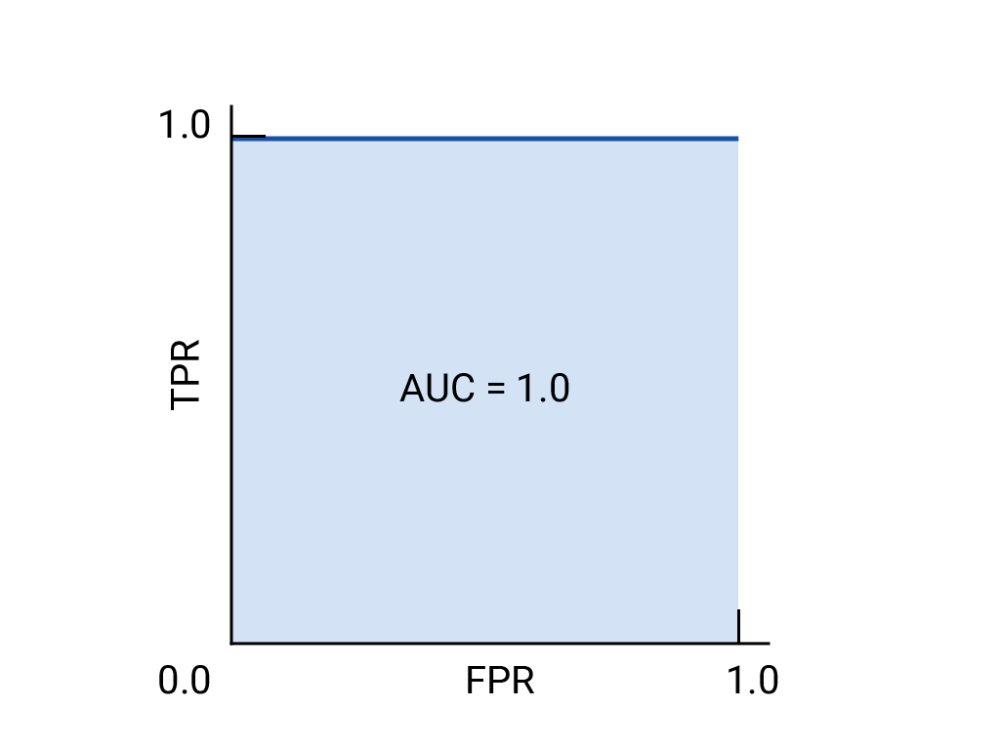

# 受试者工作特征曲线（ROC）
ROC 曲线是对模型在所有阈值下性能的可视化表示。其全称“受试者工作特征”源自二战时期的雷达探测。

ROC 曲线的绘制方法是：在每个可能的分类阈值（实际应用中通常选择一系列离散阈值）下，分别计算真正例率（TPR）和假正例率（FPR），然后以 FPR 为横轴、TPR 为纵轴绘制曲线。

一个完美的分类模型，在某个阈值下可以达到 TPR = 1.0、FPR = 0.0。如果只考虑这个阈值，可以用坐标点 (0, 1) 表示，也可以用以下方式表示：


# 曲线下面积（AUC）
ROC 曲线下面积（AUC）表示：如果给定一个随机选择的正例和一个随机选择的负例，模型将正例排在负例之前的概率。

更具体地说，AUC 为 1.0 的垃圾邮件分类器，能够正确区分任意一封垃圾邮件和正常邮件，给垃圾邮件更高的预测概率。每封邮件最终会被分到哪一类，取决于你设置的阈值。

对于二元分类器，如果模型的表现与随机猜测（例如抛硬币）完全相同，那么它的 ROC 曲线就是一条从 (0,0) 到 (1,1) 的对角线。

此时 AUC 为 0.5，表示模型正确判断随机选取的一个正样本和一个负样本的先后排序关系的概率为 50%。


# 用于模型和分类阈值选择的 AUC 与 ROC
只要数据集中的类别分布大致均衡，AUC 就是比较两个不同模型性能的一个有用指标。通常，AUC 越大的模型，性能越好。

----
# 代码

我用scikit-learn库来实现 
[auc](https://scikit-learn.org/stable/modules/generated/sklearn.metrics.auc.html)
完整代码 [breast_cancer_roc_auc_train.py](breast_cancer_roc_auc_train.py)
```python
from sklearn.metrics import roc_curve, auc
fpr, tpr, thresholds = roc_curve(y_true, y_probability)
test_auc = auc(fpr, tpr)
print(f"AUC: {test_auc}")
```
然后绘制ROC曲线
```python
from sklearn.metrics import roc_curve, auc
all_labels = []
all_probabilities = []
_model.eval()
with torch.no_grad():
    for X, y_true in test_loader:
        logits = _model(X)
        y_probability = torch.sigmoid(logits)
        all_labels.extend(y_true.cpu().numpy())
        all_probabilities.extend(y_probability.cpu().numpy())

fpr, tpr, thresholds = roc_curve(all_labels, all_probabilities)
test_auc = auc(fpr, tpr)
fpr, tpr, thresholds = roc_curve(all_labels, all_probabilities)
test_auc = auc(fpr, tpr)

plt.plot(fpr, tpr, label=f"ROC Curve (AUC = {test_auc})")

# 绘制随机猜测的参考线
plt.plot([0, 1], [0, 1], linestyle="--", label="Random Guess")
# 设置坐标轴名称
plt.xlabel("False Positive Rate")
plt.ylabel("True Positive Rate")

plt.legend()
plt.show()
```
