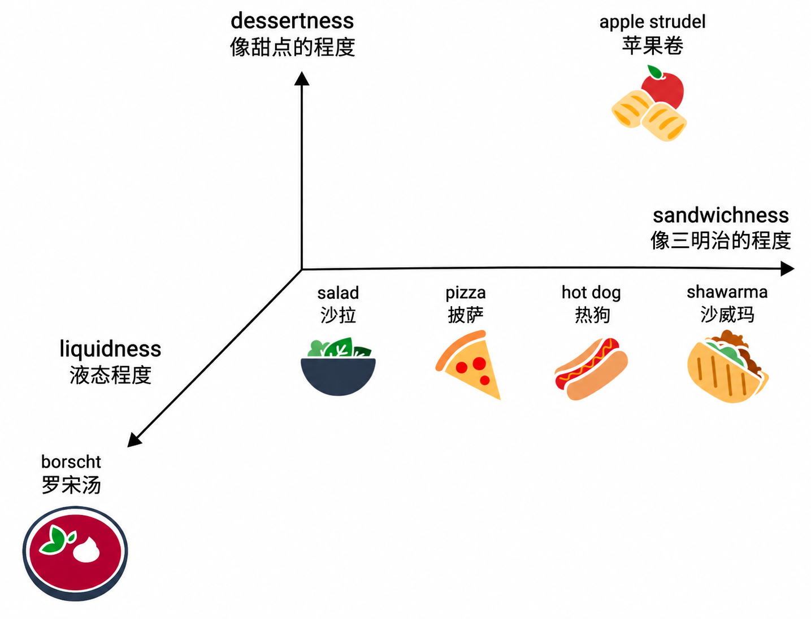
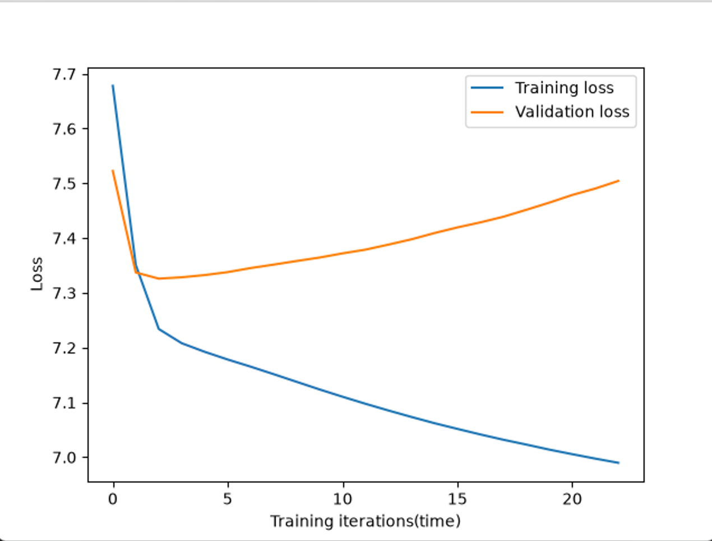

假设你正在开发一个美食推荐应用，用户输入自己喜欢的菜品，应用会推荐他们可能喜欢的类似菜品。你希望开发一个机器学习（ML）模型来预测食物之间的相似性，
从而提供高质量的推荐（“既然你喜欢煎饼，我们推荐你尝试可丽饼”）。

为了训练模型，你整理了一个包含 5,000 种热门菜品的数据集，
其中包括罗宋汤（borscht）、热狗（hot dog）、沙拉（salad）、披萨（pizza）和沙威玛（shawarma）。


你创建了一个 meal 特征，其中包含数据集中每种菜品的独热编码（One-hot encoding）表示。
编码（Encoding）是指为数据选择一种初始的数值表示形式，以便用于模型训练的过程。


## 在查看这些独热编码时，您注意到这种数据表示存在几个问题。
- 大量的输入特征意味着神经网络需要训练更多的权重。例如，使用独热编码表示5000种菜品，那么第一隐藏层中的每个神经元都需要训练5000个权重。
- 权重越多，训练和使用模型（推理）所需的计算量就越大，很容易超出硬件的处理能力。
- 菜品种类越多，通常就需要越多的训练数据，否则某个菜品在训练数据中只出现过几次，模型就很难充分学习与该菜品相关的权重。


## 下面来看 `embeddings 嵌入` 如何解决这个问题

嵌入使机器学习更容易处理高维特征向量（Feature Vector）,有时，对象在嵌入空间中的相对位置可能具有某种语义关系。
但通常，人类很难解释模型是如何找到这个低维空间，以及如何确定对象在该空间中的相对位置的，因此得到的嵌入向量也很难被人类直接理解。

不过，为了便于理解嵌入向量是如何表示信息的，我们可以将热狗（hot dog）、披萨（pizza）、沙拉（salad）、沙威玛（shawarma）和罗宋汤（borscht）放在一个一维空间中，
其取值范围从“最不像三明治”到“最像三明治”。


苹果卷（apple strudel）应该位于这条线上的什么位置呢？可以考虑将它放在热狗（hot dog）和沙威玛（shawarma）之间。


嵌入使用 n 个浮点数（通常在 -1 到 1 或 0 到 1 的范围内）来表示每个对象在 n 维空间中的位置。
在嵌入空间中，任意两个对象之间的距离都可以通过数学方法计算，并将其作为衡量两个对象相对相似性的指标。

### 还要注意，在二维空间中，苹果卷（apple strudel）与沙威玛（shawarma）和热狗（hot dog）之间的距离，比在一维空间中远得多。

现在考虑罗宋汤（borscht），与其他菜品相比，它更接近液态。这意味着我们可以引入第三个维度——液态程度（liquidness），
用于衡量食物有多接近液态。添加这个维度后，我们就可以在三维空间中对这些菜品进行可视化：


汤圆（tangyuan）应该位于这个三维空间中的什么位置呢？它像罗宋汤（borscht）一样带有汤汁，又像苹果卷（apple strudel）一样属于甜点，
而且肯定不是三明治。下面是一种可能的位置安排：


注意，仅仅三个维度就能够表达如此丰富的信息。你还可以考虑添加更多维度，例如食物的含肉程度或烘烤程度，不过四维、五维以及更高维度的空间很难进行可视化。

之前使用一维、二维、三维空间只是为了方便人类理解，而实际应用中的嵌入空间通常具有更高的维度。
实际训练时，我们不需要提前定义每个维度的含义，模型会根据训练任务和数据自行学习嵌入向量。

嵌入通常与具体的训练任务有关，不同的训练任务会产生不同的嵌入向量。

例如，素食与非素食分类模型生成的嵌入，与根据用餐时间或季节推荐菜品的模型生成的嵌入是不同的。

麦片（cereal）和早餐香肠（breakfast sausage）在根据用餐时间推荐菜品的模型中，可能在嵌入空间中彼此靠近，但在素食与非素食分类模型的嵌入空间中，它们可能相距很远。

---
# 降维技术

有许多数学技术可以捕捉高维空间中的重要结构，并将其映射到低维空间中。理论上，这些技术中的任何一种都可以用来为机器学习系统创建嵌入。

例如，主成分分析（Principal Component Analysis，PCA）已经被用于创建词嵌入。
给定一组样本，例如词袋（Bag of Words）向量，PCA 会尝试寻找高度相关的维度，并将这些维度的信息压缩到一个维度中。

> PCA 是一种经典的**降维（Dimensionality Reduction）**方法，通过构建新的主成分，在降低数据维度的同时，尽可能保留原始数据中的方差信息。

你可以在针对目标任务训练神经网络（Neural Network）的同时学习嵌入向量。这种方法可以获得更加适合特定系统的嵌入向量，
但可能比单独训练嵌入向量花费更长的时间。

一般来说，你可以在神经网络中创建一个包含 \(d\) 个神经元的隐藏层，并将其指定为嵌入层（Embedding Layer），
其中 \(d\) 既表示隐藏层中的神经元数量，也表示嵌入空间的维度数量。

回到我们的美食推荐示例，我们的目标是根据用户当前喜欢的菜品，预测用户可能喜欢的新菜品。

首先，我们可以收集用户最喜欢的五种食物的数据，然后将这个任务建模为一个监督学习（Supervised Learning）问题。

我们从这五种食物中随机选出一种作为模型需要预测的正标签（Positive Label），其余四种作为输入特征，并使用 Softmax 损失函数来优化模型的预测结果。

在训练过程中，神经网络模型会学习第一个隐藏层中神经元的最优权重，该隐藏层作为嵌入层（Embedding Layer）。

例如，如果模型的第一个隐藏层包含三个神经元，它可能会学习到菜品最相关的三个维度：像三明治的程度（sandwichness）、像甜点的程度（dessertness）和液态程度（liquidness）。

下图 展示了热狗（hot dog）的独热编码输入是如何被转换为一个三维嵌入向量的。


---
## 代码部分
Google 拿食物举例，收集用户最喜欢的五种食物， 将五种食物中的四种设为特征数据， 然后随机将第五种食物留出作为模型的标签，
使用 softmax 损失来优化模型预测， 我找 gpt 老师教我写这个练习， 但结果并不好， 是我机器学习知识还不足， 还得多练， 
不过我现在还没想在嵌入上面下太多功夫， 即使不好， 也先这样吧

本次练习使用的 Recipes and Ratings 数据集

[Recipes and Ratings](https://practicaldsc.org/sp25/final-project/datasets/recipes-and-ratings)

完整的代码在 [recipes_torch.py](recipes_torch.py)

训练目标是输入4个食物， 预测一个食物（老实说我看不懂）
现在数据集有个问题，就是很多菜谱只有一条评论， 这让模型很难学习菜谱之间的关系， 这个问题可以被称为 **数据稀疏（Data Sparsity）**。

首先统计每种菜谱被多少个不同的用户评价过。
这一步是为了统计每种菜谱的用户覆盖数量，方便后续过滤低频菜谱。
```python
# groupby("recipe_id")：按照菜谱ID进行分组。
# ["user_id"]：获取每组中的用户ID。
# nunique()：统计不同用户的数量，重复用户只计算一次。
recipe_counts = RAW_interactions_pd.groupby("recipe_id")["user_id"].nunique()
```
然后按照用户数量降序排列, 这一步删除也不会影响训练
```python
# sort_values()根据Series的值进行排序。
# - ascending = True：升序，从小到大。
# - ascending = False：降序，从大到小。
#  这个是为了打印方便
recipe_counts = recipe_counts.sort_values(ascending=False)
```


获取至少被 30 个不同用户评价过的菜谱 ID。
```python
valid_recipes = recipe_counts[recipe_counts >= 30].index
```

然后把低频菜谱从数据中删除
```python
RAW_interactions_pd = RAW_interactions_pd[
    RAW_interactions_pd["recipe_id"].isin(valid_recipes)
].reset_index(drop=True)
```

`RAW_interactions_pd["recipe_id"].isin(valid_recipes)` 的 isin() 用来判断每条评价的 recipe_id 是否存在于 valid_recipes 中。

---

我们的训练任务需要每个用户提供至少五种不同的菜谱，其中四种作为输入特征，一种作为标签。所以需要删除评论少于5个的用户

```python
user_counts = RAW_interactions_pd.groupby("user_id")["recipe_id"].nunique()
users = user_counts[user_counts >= 5].index.tolist()
```

划分训练集、验证集和测试集
```python
users_train, users_temp = train_test_split(
    users, train_size=0.8, random_state=42
)

users_val, users_test = train_test_split(
    users_temp, train_size=0.5, random_state=42
)
```
现在已经将用户划分为三个集合，分别是训练集、验证集和测试集。然后根据这些用户获取对应的菜谱 ID，构建训练输入和标签。
由于原始菜谱 ID 不连续，直接作为 Embedding 的索引会浪费大量空间，所以需要将菜谱 ID 映射为从 0 开始的连续整数索引，
作为模型的输入和标签。 
```python
def build_samples(userlist) -> tuple[torch.Tensor, torch.Tensor]:
    __x = []
    __y = []
    for user_id in userlist:
        recipes = RAW_interactions_pd.loc[
            RAW_interactions_pd["user_id"] == user_id,
            ["recipe_id", "rating"]
        ]
        recipes = recipes.sort_values("rating", ascending=False)
        recipes = recipes.drop_duplicates(subset="recipe_id").head(5)

        recipe_ids = recipes["recipe_id"].tolist()

        ___x = []
        for recipe_id in recipe_ids:
            if recipe_id not in recipe_id_to_index:
                recipe_id_to_index[recipe_id] = len(recipe_id_to_index)

            ___x.append(recipe_id_to_index[recipe_id])
        # 每种菜谱轮流作为标签
        for i in range(len(___x)):
            __x.append(___x[:i] + ___x[i + 1:])
            __y.append(___x[i])

    _x = torch.tensor(__x, dtype=torch.long)
    _y = torch.tensor(__y, dtype=torch.long)

    return _x, _y

# 分别获取三个数据集
x_train, y_train = build_samples(users_train)
x_val, y_val = build_samples(users_val)
x_test, y_test = build_samples(users_test)
```

损失函数仍然使用之前多分类任务中学习过的交叉熵损失函数（Cross Entropy Loss）。
```python
# 损失函数
loss_fn = torch.nn.CrossEntropyLoss().to(_device)
```

但是模型要改一下， `torch.nn.Embedding` 是 PyTorch 提供的嵌入层（Embedding Layer）
而且神经网络很小是因为不是越深越好， 我测试后发现这个层数的过拟合程度要比更深的神经网络轻
```python
class FoodClassifier(torch.nn.Module):
    def __init__(self, *args: Any, **kwargs: Any):
        super().__init__(*args, **kwargs)

        self.embedding = torch.nn.Embedding(
            num_embeddings=2420,
            embedding_dim=3
        )
        self.network = torch.nn.Sequential(

            torch.nn.Linear(in_features=3, out_features=8),
            torch.nn.ReLU(),

            torch.nn.Linear(in_features=8, out_features=2420),
        )

    def forward(self, x):
        # 前向传播
        x = self.embedding(x)
        x = x.mean(dim=1)
        return self.network(x)
```


优化器我想尝试一下之前看起来很牛逼但是没用过的 `moun` 优化器
这次我用 `moun` 和 `adamw` 优化器， 只有输入层用 `moun`
这个修改比单纯的用 AdamW 只好一点没有明显的改善
```python
# 优化器
muon_params = []
adamw_params = []

for name, param in _model.named_parameters():
    if name == "network.0.weight":
        muon_params.append(param)
    else:
        adamw_params.append(param)
    print(name)

_optimizer_muon = torch.optim.Muon(
    muon_params,
    lr=_learning_rate,
    weight_decay=_weight_decay
)

_optimizer_adamw = torch.optim.AdamW(
    adamw_params,
    lr=_learning_rate,
    weight_decay=_weight_decay
)
```

因为用了两个优化器所以训练时的梯度下降也要改
```python
# 3. 反向传播
optimizer_adamw.zero_grad()  # 清空之前的梯度
optimizer_muon.zero_grad()  # 清空之前的梯度

loss.backward()  # 计算梯度

optimizer_adamw.step()  # 更新模型参数
optimizer_muon.step()  # 更新模型参数
```

到最后模型过拟合程度仍然很高， 我修改了优化器的正则化， 效果并不好

所以最后只好用 早停法 让模型停在一个还算不错的 loss 下，虽然效果还是不好但是这个训练方向从一开始就不指望可以训练的太好， 只是想试试 google 讲的内容



