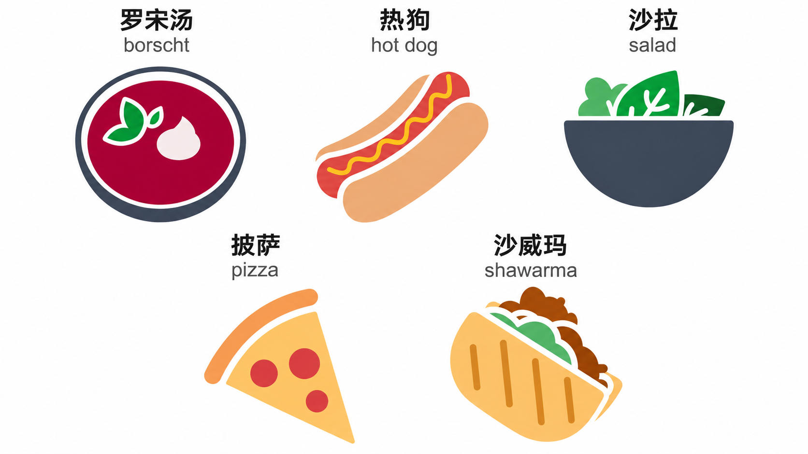
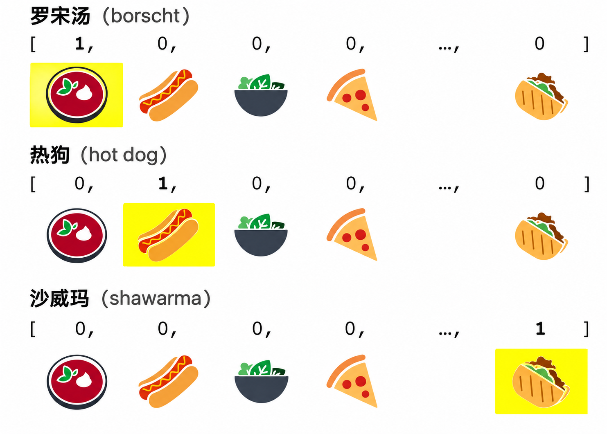
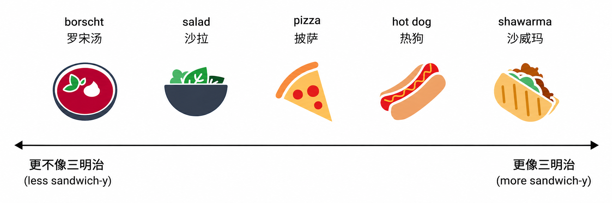
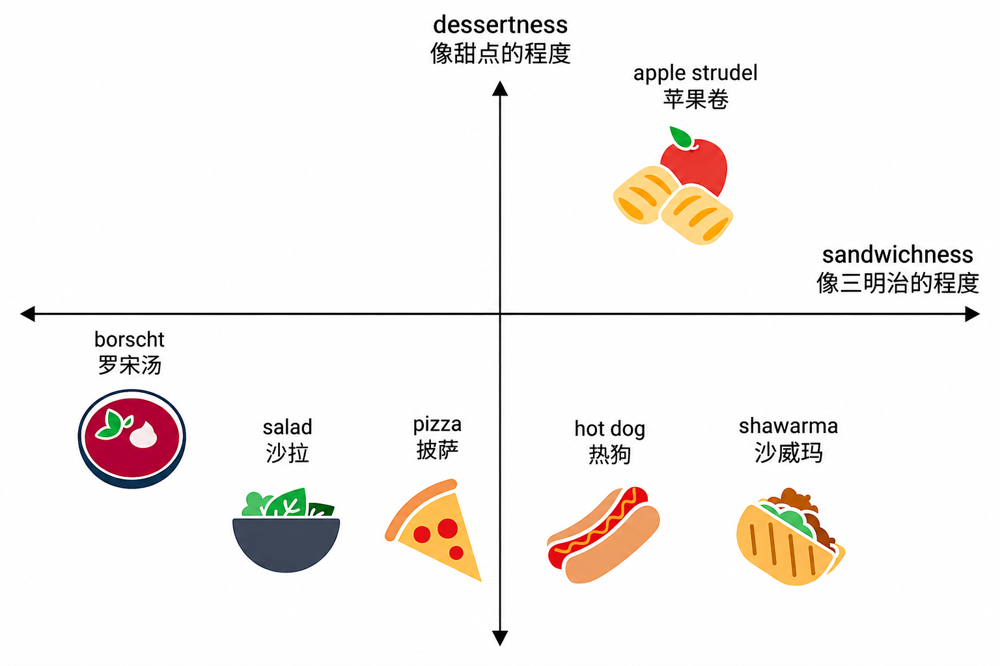
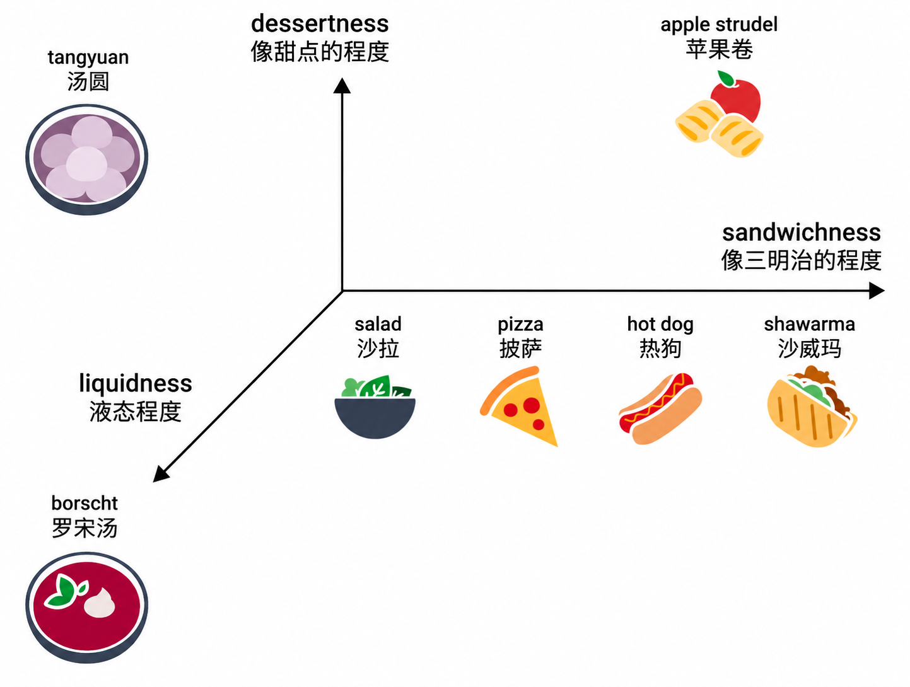
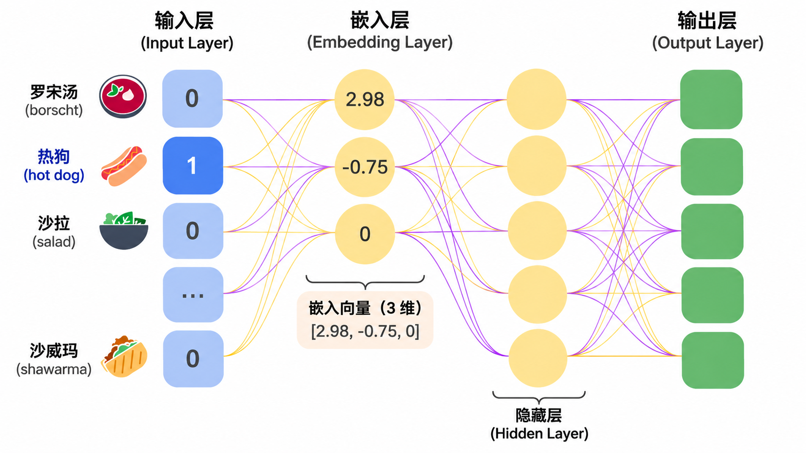
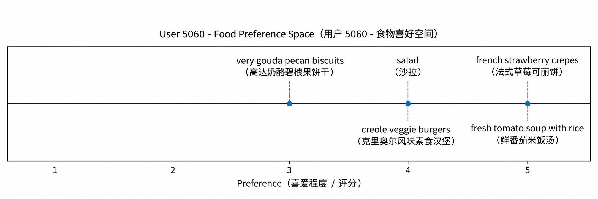

假设你正在开发一个美食推荐应用，用户输入自己喜欢的菜品，应用会推荐他们可能喜欢的类似菜品。你希望开发一个机器学习（ML）模型来预测食物之间的相似性，
从而提供高质量的推荐（“既然你喜欢煎饼，我们推荐你尝试可丽饼”）。

为了训练模型，你整理了一个包含 5,000 种热门菜品的数据集，
其中包括罗宋汤（borscht）、热狗（hot dog）、沙拉（salad）、披萨（pizza）和沙威玛（shawarma）。



你创建了一个 meal 特征，其中包含数据集中每种菜品的独热编码（One-hot encoding）表示。
编码（Encoding）是指为数据选择一种初始的数值表示形式，以便用于模型训练的过程。



## 在查看这些独热编码时，您注意到这种数据表示存在几个问题。
- 大量的输入特征意味着神经网络需要训练更多的权重。例如，使用独热编码表示5000种菜品，那么第一隐藏层中的每个神经元都需要训练5000个权重。
- 权重越多，训练和使用模型（推理）所需的计算量就越大，很容易超出硬件的处理能力。
- 菜品种类越多，通常就需要越多的训练数据，否则某个菜品在训练数据中只出现过几次，模型就很难充分学习与该菜品相关的权重。


## 下面来看 `embeddings 嵌入` 如何解决这个问题

嵌入使机器学习更容易处理高维特征向量（Feature Vector）,有时，对象在嵌入空间中的相对位置可能具有某种语义关系。
但通常，人类很难解释模型是如何找到这个低维空间，以及如何确定对象在该空间中的相对位置的，因此得到的嵌入向量也很难被人类直接理解。

不过，为了便于理解嵌入向量是如何表示信息的，我们可以将热狗（hot dog）、披萨（pizza）、沙拉（salad）、沙威玛（shawarma）和罗宋汤（borscht）放在一个一维空间中，
其取值范围从“最不像三明治”到“最像三明治”。



苹果卷（apple strudel）应该位于这条线上的什么位置呢？可以考虑将它放在热狗（hot dog）和沙威玛（shawarma）之间。


嵌入使用 n 个浮点数（通常在 -1 到 1 或 0 到 1 的范围内）来表示每个对象在 n 维空间中的位置。
在嵌入空间中，任意两个对象之间的距离都可以通过数学方法计算，并将其作为衡量两个对象相对相似性的指标。

### 还要注意，在二维空间中，苹果卷（apple strudel）与沙威玛（shawarma）和热狗（hot dog）之间的距离，比在一维空间中远得多。

现在考虑罗宋汤（borscht），与其他菜品相比，它更接近液态。这意味着我们可以引入第三个维度——液态程度（liquidness），
用于衡量食物有多接近液态。添加这个维度后，我们就可以在三维空间中对这些菜品进行可视化：


汤圆（tangyuan）应该位于这个三维空间中的什么位置呢？它像罗宋汤（borscht）一样带有汤汁，又像苹果卷（apple strudel）一样属于甜点，
而且肯定不是三明治。下面是一种可能的位置安排：


注意，仅仅三个维度就能够表达如此丰富的信息。你还可以考虑添加更多维度，例如食物的含肉程度或烘烤程度，不过四维、五维以及更高维度的空间很难进行可视化。

之前使用一维、二维、三维空间只是为了方便人类理解，而实际应用中的嵌入空间通常具有更高的维度。
实际训练时，我们不需要提前定义每个维度的含义，模型会根据训练任务和数据自行学习嵌入向量。

嵌入通常与具体的训练任务有关，不同的训练任务会产生不同的嵌入向量。

例如，素食与非素食分类模型生成的嵌入，与根据用餐时间或季节推荐菜品的模型生成的嵌入是不同的。

麦片（cereal）和早餐香肠（breakfast sausage）在根据用餐时间推荐菜品的模型中，可能在嵌入空间中彼此靠近，但在素食与非素食分类模型的嵌入空间中，它们可能相距很远。

---
# 降维技术

有许多数学技术可以捕捉高维空间中的重要结构，并将其映射到低维空间中。理论上，这些技术中的任何一种都可以用来为机器学习系统创建嵌入。

例如，主成分分析（Principal Component Analysis，PCA）已经被用于创建词嵌入。
给定一组样本，例如词袋（Bag of Words）向量，PCA 会尝试寻找高度相关的维度，并将这些维度的信息压缩到一个维度中。

> PCA 是一种经典的**降维（Dimensionality Reduction）**方法，通过构建新的主成分，在降低数据维度的同时，尽可能保留原始数据中的方差信息。

你可以在针对目标任务训练神经网络（Neural Network）的同时学习嵌入向量。这种方法可以获得更加适合特定系统的嵌入向量，
但可能比单独训练嵌入向量花费更长的时间。

一般来说，你可以在神经网络中创建一个包含 \(d\) 个神经元的隐藏层，并将其指定为嵌入层（Embedding Layer），
其中 \(d\) 既表示隐藏层中的神经元数量，也表示嵌入空间的维度数量。

回到我们的美食推荐示例，我们的目标是根据用户当前喜欢的菜品，预测用户可能喜欢的新菜品。

首先，我们可以收集用户最喜欢的五种食物的数据，然后将这个任务建模为一个监督学习（Supervised Learning）问题。

我们从这五种食物中随机选出一种作为模型需要预测的正标签（Positive Label），其余四种作为输入特征，并使用 Softmax 损失函数来优化模型的预测结果。

在训练过程中，神经网络模型会学习第一个隐藏层中神经元的最优权重，该隐藏层作为嵌入层（Embedding Layer）。

例如，如果模型的第一个隐藏层包含三个神经元，它可能会学习到菜品最相关的三个维度：像三明治的程度（sandwichness）、像甜点的程度（dessertness）和液态程度（liquidness）。

下图 展示了热狗（hot dog）的独热编码输入是如何被转换为一个三维嵌入向量的。


---
## 代码部分

本次练习使用， Recipes and Ratings 数据集

[Recipes and Ratings](https://practicaldsc.org/sp25/final-project/datasets/recipes-and-ratings)

这个数据集有两个 csv, RAW_interactions.csv 和 RAW_recipes.csv。

RAW_interactions.csv 包含针对 RAW_recipes.csv 中食谱提交的评论和评分。
RAW_recipes.csv 包含食谱。

两个csv的关系是， interactions是用户对  recipes食谱 的评价， 有83782个食物， 731927条评价, 但是有的用户评价找不到对应的食谱， 
经过我的筛选有效的评论只有 234428 条
```python
from pathlib import Path

import pandas as pd

RAW_interactions = Path(__file__).parent.parent / "data" / "RAW_interactions.csv"
RAW_interactions_pd = pd.read_csv(RAW_interactions)

RAW_recipes = Path(__file__).parent.parent / "data" / "RAW_recipes.csv"
RAW_recipes_pd = pd.read_csv(RAW_recipes)

# 清理无效评论
_drop_id = []
for i in range(RAW_interactions_pd.shape[0]):
    user_id = RAW_interactions_pd['user_id'][i]
    recipe_id = RAW_interactions_pd['recipe_id'][i]
    rating = RAW_interactions_pd['rating'][i]
    recipes_name:pd.Series = RAW_recipes_pd.loc[RAW_recipes_pd['id'] == recipe_id, 'name']
    if recipes_name.empty:
        _drop_id.append(i)
RAW_interactions_pd = RAW_interactions_pd.drop(index = _drop_id)
RAW_interactions_pd.to_csv(Path(__file__).parent.parent / "data" / "RAW_interactions_cleaned.csv", index=False)
print(f"{RAW_interactions_pd.shape}") # (234428, 5)
```

我现在希望可以像Google一样绘制分布图， 追踪一个用户并分析他的喜好， 用户 id 为 5060 , 先试试他的。
从他的食物里选五个：
- very gouda pecan biscuits	高达奶酪碧根果饼干
- salad	沙拉
- creole veggie burgers	克里奥尔风味素食汉堡
- french strawberry crepes	法式草莓可丽饼
- fresh tomato soup with rice	鲜番茄米饭汤


可以看到，这里手动选取了部分数据，用评分来表示用户对食物的喜爱程度。但是由于评分的取值范围有限，导致大量评分相同的食物在空间中重合。
当前没有引入其他具有明确含义的特征，因此暂时只进行一维空间的可视化。
