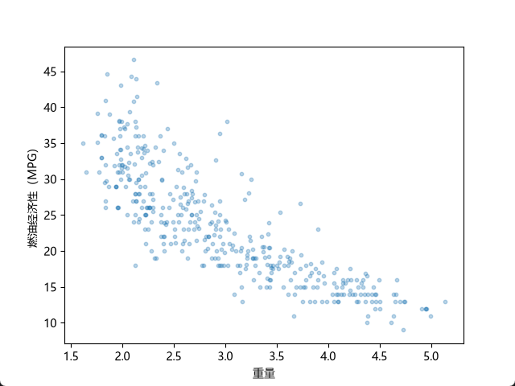
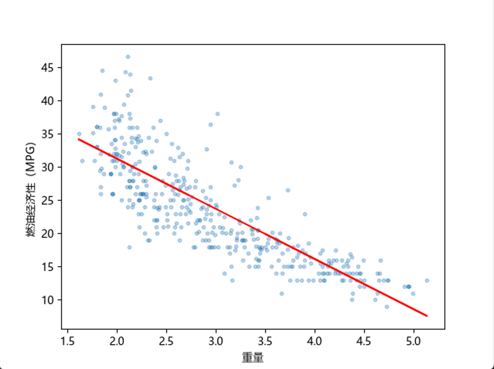

# 损失函数loss

[线性回归：损失](https://developers.google.com/machine-learning/crash-course/linear-regression/loss)

[常见的损失函数(loss function)总结](https://zhuanlan.zhihu.com/p/58883095)

[《动手学深度学习》](https://zh.d2l.ai/chapter_preface/index.html)

[loss functions Pytorch)](https://docs.pytorch.org/docs/2.15/nn.html#loss-functions)

[Pytorch Quickstart](https://docs.pytorch.org/tutorials/beginner/basics/quickstart_tutorial.html)

[PyTorch 线性回归 菜鸟](https://www.runoob.com/pytorch/pytorch-linear-regression.html)

损失函数， 是在训练过程中负责衡量错了多少，以及错误有多严重。 优化器根据损失函数产生的梯度，决定如何调整模型参数。

在线性回归中，常见的损失函数有  [平均绝对误差  MAE](https://docs.pytorch.org/docs/2.15/generated/torch.nn.L1Loss.html#torch.nn.L1Loss)、[均方误差 MSE](https://docs.pytorch.org/docs/2.15/generated/torch.nn.MSELoss.html) 、Huber Loss、Smooth L1
MSE 是最常用的损失函数之一。

为什么使用 均方误差（MSE）？

因为 MSE 会对误差进行平方，使较大的预测误差受到更强的惩罚，从而让模型在训练时更加重视大误差。
因为梯度下降（Gradient Descent）利用导数（梯度）来更新模型参数，而 MSE 的求导过程简单，且导数连续、平滑，因此适合使用梯度下降进行优化。

MSE 对较大的预测误差采用平方惩罚，因此容易受到离群值（Outliers）的影响。当数据中存在较多离群值时，可以考虑使用 Huber Loss，提高模型训练的稳健性（Robustness）。

MSE 通常不适合分类任务。当 MSE 与 Sigmoid 激活函数配合使用时，容易出现梯度过小的问题，尤其是在模型自信地预测错误时，可能导致训练缓慢。
因此，分类任务通常使用交叉熵（Cross Entropy）等损失函数。
二分类使用BCEWithLogitsLoss
多分类使用CrossEntropyLoss

Softmax 和 CE（Cross Entropy，交叉熵）经常搭配使用，主要用于单标签多分类任务。

需要注意的是，PyTorch 的 `BCEWithLogitsLoss` 已经在内部结合了 Sigmoid 和 BCE，因此模型输出层不需要再添加 Sigmoid。
同样，`CrossEntropyLoss` 内部已经包含了 LogSoftmax，因此使用它时，模型输出层也不需要再添加 Softmax。

上面简单了解了回归与分类任务中常见的损失函数，以及它们之间的区别。

接下来，我们还是回到之前的线性回归任务，通过实际代码来进一步了解损失函数。
这次更新了之前的线性回归代码，让它更符合 PyTorch 官方教程的代码风格：[mpg_torch_1f.py](./mpg_torch_1f.py)。
同时，使用 GPT 老师帮我找到的 Auto MPG 数据集，以汽车重量（weight）作为输入特征，预测燃油经济性（mpg）。

在训练轮数（Epochs）为 200、批量大小（Batch Size）为 32、学习率（Learning Rate）为 0.01 的情况下，使用 MAE（L1Loss）训练的模型拟合效果不太理想。
当更换为 MSE（MSELoss）后，在相同训练配置下，模型的拟合效果明显改善。
不过，当继续增加训练轮数时，使用 MAE 的模型也能够达到接近 MSE 的拟合效果。
这说明，在当前实验条件下，MSE 的收敛速度可能比 MAE 更快，但并不意味着 MAE 无法完成相同的回归任务。
这与两种损失函数的梯度特性有关：MSE 的梯度大小随预测误差变化，而 MAE 的梯度大小基本恒定，因此两者在优化过程中的表现可能不同。

#### 尝试 Huber Loss
Huber Loss 结合了 MSE 和 MAE 的特点，但实验中发现，它的收敛速度也比较慢。
MSE 大约 20 Epoch 就能得到不错的拟合效果，而 Huber Loss 在 2000 Epoch 时才得到了较好的结果。继续增加到 3000 Epoch，变化也不明显。
这是因为 Huber Loss 在误差较大时采用线性惩罚，限制了梯度大小，因此在当前训练配置下，收敛可能比 MSE 慢。
**Huber Loss 的优势是对离群值更加稳健，而不是训练速度更快。**

最后尝试了 SmoothL1Loss，发现它与 Huber Loss 一样，大约需要 2000 Epoch 才能得到较好的拟合效果。
这是因为 PyTorch 默认参数下，SmoothL1Loss 与 Huber Loss 的计算方式相同，因此两者具有相同的优化特性。

