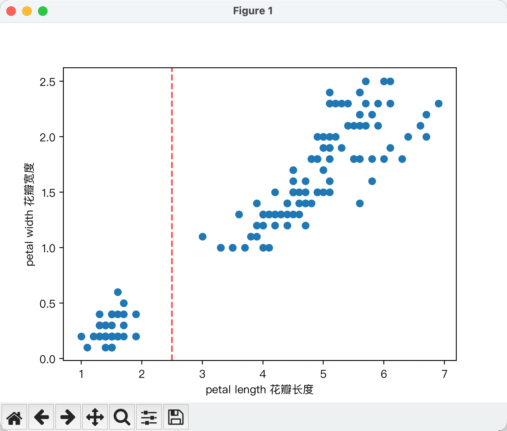

# 数据处理-分箱

分箱 （也称分桶 ）是一种 特征工程 将不同的数值子范围分组到不同的区间中的技术 分桶 。在许多情况下，分桶会将数值数据转换为类别数据。例如，考虑一个特征 设 X 为一个集合，其最小值为 15，最大值为 425。使用分箱法，可以将 X 分成以下五个箱：
- 第一箱：15至34
- 第二箱：35 至 117
- 第 3 箱：118 至 279
- 第 4 箱：280 至 392
- 第5箱：393至425

 第 1 个区间涵盖 15 到 34，因此 X 的每个值介于 15 和 34 之间都会落入第 1 个区间。基于这些区间训练的模型对 X 值 17 和 29 的反应不会有任何不同，因为这两个值都在第 1 个区间内。

在某些情况下，分箱（Binning）可以作为缩放（Scaling）的一个很好的替代方案。（Scaling 和 Normalization（归一化）意思相近，但不完全等价。）

- 特征与标签之间的整体线性关系较弱，或者根本不存在线性关系。
- 特征值呈现明显的聚集现象。

下面的数据是[鸢尾花数据](https://archive.ics.uci.edu/dataset/53/iris)
我用花瓣长度预测花瓣宽度， 完整的代码在[binning_train.py](binning_train.py)

整个训练的过程大概是 读取数据 -> 分箱 -> 编码(比如独热编码) -> 处理数据集 -> 训练

-> 编码也不是必须要做的一步， 但是一般要做

我这里分桶分了两个桶， 0-2.5 和 2.5-8， 用pandas库里的`pd.cut`来分
[Pandas pd.cut() 函数](https://www.runoob.com/pandas/pandas-pd-cut.html)
pd.cut() 是 Pandas 库中用于将连续数据分箱（Binning）的函数。它将数值数据按照指定的区间划分为离散的类别，非常适合用于数据分析中的分组统计和可视化。


```python
# 分箱
bins = [0, 2.5, 8]
categories = pd.cut(_train_df["petal length"], bins)
```
还可以给分箱贴label
```python
# 分箱
bins = [0, 2.5, 8]
_labels = ["短花瓣", "长花瓣"]
categories = pd.cut(_train_df["petal length"], bins, labels=_labels)
```

这样 categories.value_counts() 就会直接显示“短花瓣”和“长花瓣”的样本数量。
> petal length
> 长花瓣    80
> 短花瓣    40
> Name: count, dtype: int64



然后是编码, 独热编码, 现在我只是了解这个概念， 先写出来， 后面单独看
```python
encoded = pd.get_dummies(categories, dtype=int)
```

独热把短花瓣  长花瓣分成了两组， 所以在模型定义时需要有两个输入 `torch.nn.Linear(in_features=2, out_features=1)`

> 短花瓣  长花瓣
>143    0    1
>56     0    1
>45     1    0
>131    0    1
>36     1    0
>73     0    1
>76     0    1
>104    0    1
>31     1    0
>9      1    0
>12     1    0


然后处理训练集
部分代码
```python
# to tensor
_x = torch.tensor(encoded.to_numpy(), dtype=torch.float32)
_label = torch.tensor(_label_df.to_numpy(), dtype=torch.float32)

# to TensorDataset
_train_dataset = TensorDataset(_x, _label)

# to data load
_train_dataload = DataLoader(_train_dataset, batch_size=_batch_size, shuffle=True)
```

训练
```python
for t in range(_epochs):
    print(f"Epoch {t + 1}\n-------------------------------")
    train(
        train_load=_train_dataload,
        model=_model, optimizer=_optimizer,
        loss_fn=_loss_fn)
    test(
        test_load=_val_dataload,
        model=_model,
        loss_fn=_loss_fn)

    print("Done!")

test(
    test_load=_test_dataload,
    model=_model,
    loss_fn=_loss_fn)
```
现在也只是简单了解一下分箱， 数据处理部分还有很多要研究， 分箱等到以后需要的时候在研究