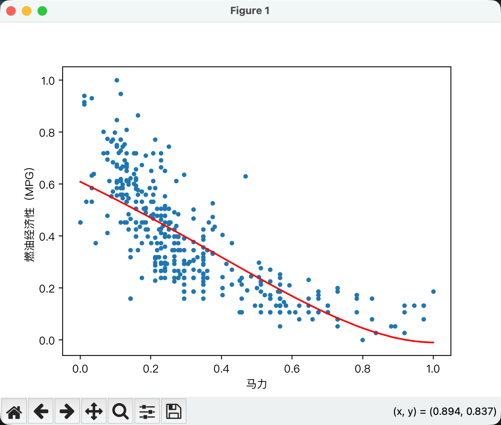

# 数据处理-多项式变换
当我在训练模型时， 数据集只有一个输入， 但是单纯的线性变换无法充分拟合我的需求， 我可以通过Polynomial Features（多项式特征）增加输入特征， 通过增加多项式特征，让原来的线性模型能够拟合更复杂的非线性关系。

比如，新的输入特征 $x_2$ 可以是原始特征 $x_1$ 的平方。
$$
x_2 = x_1^2
$$
也可以进行`立方`, `四次方`, `五次方`来得到更多的输入特征

---

如果你对某个特征进行变换，导致其数值尺度发生变化，那么也应该考虑尝试归一化。

先进行特征变换，再进行归一化，可能会改善模型的表现。

----
代码阶段
数据集用Auto MPG 数据集，以汽车horsepower作为输入特征，预测燃油经济性（mpg）。
训练使用`平方`, `立方`, `四次方`, `五次方`来增加输入特征项， 训练一个5个输入的模型， 最终绘制拟合线时， 加入多项式特征后，模型能够拟合出非线性曲线。从图像上看，曲线比原来的直线更贴近部分数据的变化趋势，但是否具有更好的预测效果，还需要通过测试集验证。， 感谢Gpt老师教我写的代码
[polynomial_train.py](polynomial_train.py)

这是本次训练的结果

模型预测现实世界的问题时，必须考虑真正影响结果的因素。多项式特征并不能替代真实的数据
