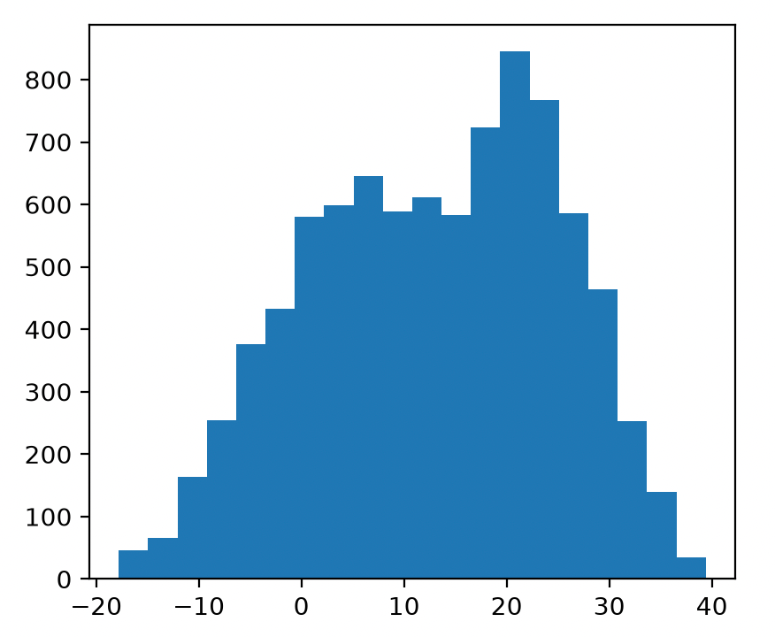
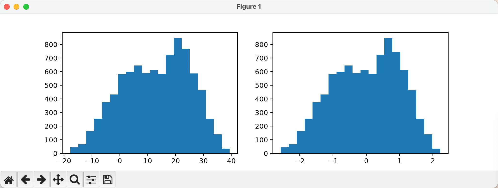
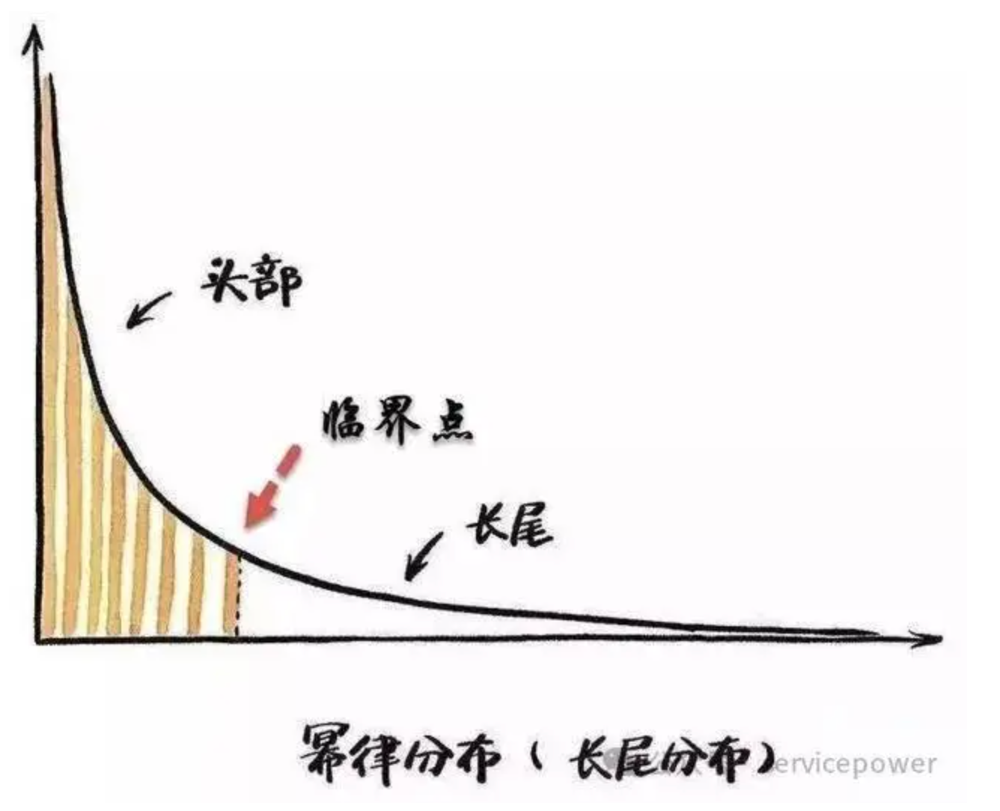
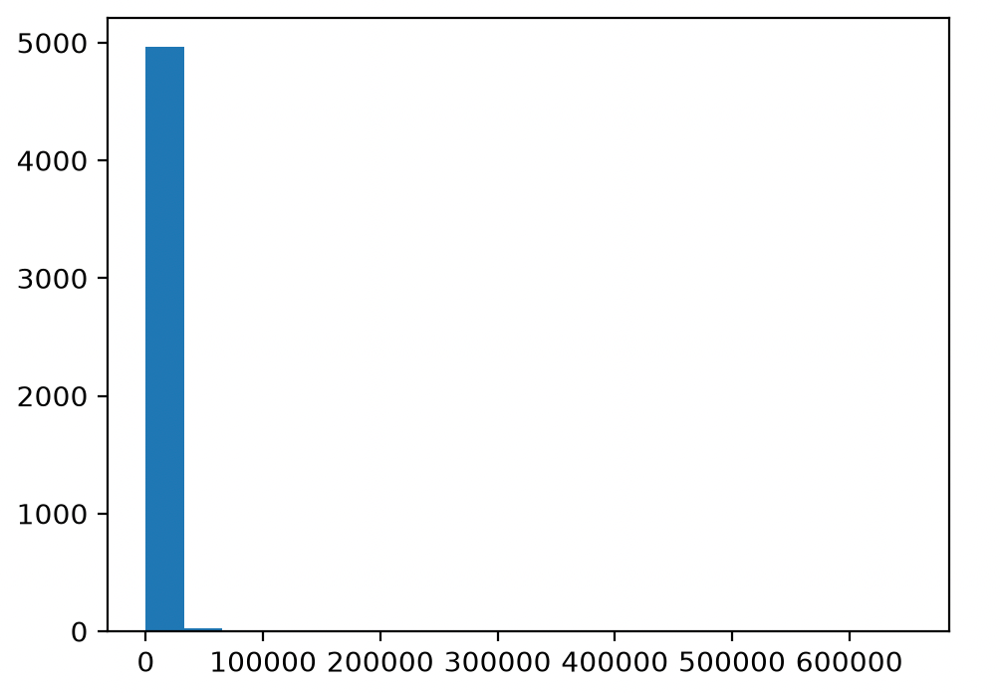
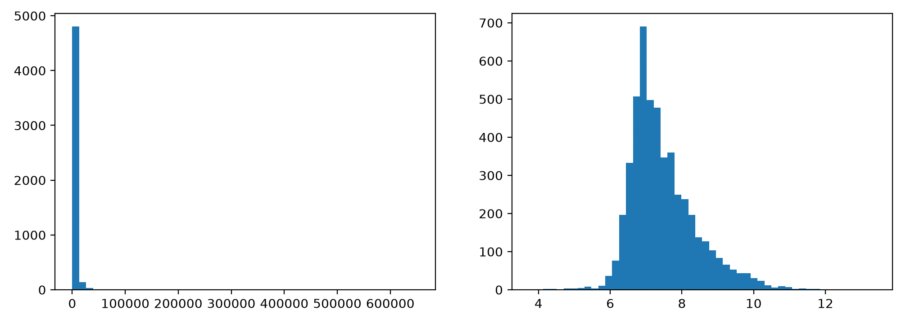

# 数据处理-归一化
机器学习从业者花费在评估、清洗和转换数据上的时间远远超过构建模型的时间。数据如此重要，以至于本课程专门用三个单元来讲解这个主题：

所以在学习更多内容之前， 花点时间学习和练习处理数据还是有必要的


通常训练很少直接使用数据集的原始值， 通常需要将数据集的值处理成模型更容易学习的表示形式。

处理过的数据可以拿到比真实数据更好的结果

将原始数据集处理成可训练值， 这个过程叫做  特征工程 `feature engineering`

最常见的特征工程技术包括：
- Normalization: 归一化：将数值转换为标准范围。
- Binning 分箱， 也可以叫 bucketing 分桶 ： 将数值转换为范围桶。

# Normalization: 归一化
有一个数据， X范围为 154 到 24,917,482。Y 取值范围为 5 到 22。这两个范围差距非常大， 可能影响模型的训练效率。**归一化** 可以把X映射到0-1
归一化具有以下优点：
- 有助于模型在训练过程中更快地收敛 。
- 有助于模型做出更准确的预测 。当不同特征的取值范围不同时，模型的预测效果可能会有所下降。
- 有助于避免特征值非常高时出现“NaN 陷阱” 。
- 特征缩放有助于模型学习每个特征的合适权重 。

建议对 X和Y都进行归一化处理

> 如果在训练期间对某个特征进行归一化，则在进行预测时也必须对该特征进行归一化。

本节介绍三种常用的归一化方法：
- linear scaling  线性缩放
- Z-score scaling  Z 分数缩放
- log scaling  对数缩放

# Linear scaling  线性缩放
线性缩放 （通常简称为缩放 ）是指将浮点值从其自然范围转换为标准范围——通常是 0 到 1 或 -1 到 +1。

$$
x' = (x - x_{min}) /（x_{max} - x_{min}）
$$
> 这是我唯一能看懂的公式吗（悲）


当满足以下所有条件时，线性缩放是一个不错的选择：
- 随着时间的推移，数据的下限和上限变化不大。
- 该特征几乎没有异常值，而且这些异常值也并不极端。
- 该特征在其取值范围内近似均匀分布。也就是说，直方图会显示大多数值的柱状图大致均匀。

> 注意： 大多数实际特征并不完全符合线性缩放的标准。通常情况下，Z 分数缩放比线性缩放是更好的归一化选择。

# Z-score scaling  Z 分数缩放
Z 分数表示一个值与均值之间的标准差个数。例如，比均值大 2 个标准差的值的 Z 分数为 +2.0。比均值小 1.5 个标准差的值的 Z 分数为 -1.5。

$$
x' = (x - \mu）/ \sigma
$$

$x'$ 是 Z 分数。
$x$是原始值；也就是说，$x$是你要归一化的值。
$\mu$ 是平均值。
$\sigma$ 是标准差。

当数据服从正态分布或类似于正态分布的分布时，Z 分数是一个不错的选择。

# Log scaling  对数缩放
对数缩放计算的是原始值的对数。理论上，对数可以是任何底数；实际上，对数缩放通常计算自然对数（ln）。

$$
x' = ln(x)
$$
$x'$是 $x$ 的自然对数。
ln 就是 log 的一种，区别在于底数。就是 NumPy 的 np.log(x)。

**当数据符合幂律分布时，对数缩放非常有用。** 简单来说，幂律分布如下所示：
幂律分布通常表现为少量极大的数值和大量较小的数值。对数缩放可以压缩较大数值之间的差距。

# Clipping
Clipping是一种旨在最大限度降低极端异常值影响的技术。简而言之，Clipping通常会将异常值的值限制（降低）到一个特定的最大值。

---
# 实验阶段
### Linear scaling  线性缩放使用[能源效率](https://archive.ics.uci.edu/dataset/242/energy+efficiency)数据集
[linear_scaling.py](linear_scaling.py)

```python
from sklearn.preprocessing import MinMaxScaler

# 创建缩放器，默认范围 [0, 1]
scaler = MinMaxScaler()
# 计算每列的最小值、最大值并缩放
x_scaled = scaler.fit_transform(_x)
# 转回 Tensor
x_scaled = torch.as_tensor(x_scaled, dtype=torch.float32)
```
或者用手动计算
```python
x_min = _x.min(dim=0).values
x_max = _x.max(dim=0).values
_linear_scaling = (_x- x_min) / (x_max - x_min)
```

### Z-score scaling Z分数缩放
数据集使用， [首尔自行车共享需求](https://archive.ics.uci.edu/dataset/560/seoul+bike+sharing+demand)
[z_score_scaling.py](z_score_scaling.py)
因为正态分布的数据比较适合 Z分数缩放， 而 “首尔自行车共享需求” 数据集里的 `Temperature` 比较符合正态分布
正态分布的概率密度函数显示为典型的钟形曲线， 我们用 直方图 绘制一下 `Temperature`字段， 确认一下他是否符合正态分布
正态分布的概率密度函数，画出来就是一条平滑、左右对称的钟形曲线。下面的图虽然不是很典型正态分布， 但也大差不多， 就当他是了

```python
z_score_scaling = (X["Temperature"] - X["Temperature"].mean()) / X["Temperature"].std(ddof=0)
```
缩放后， 结果还不错


# Log scaling  对数缩放
当数据符合幂律分布时，对数缩放非常有用。GPT老师帮我找了一个合适的数据集， [网络新闻受欢迎程度](https://archive.ics.uci.edu/dataset/332/online+news+popularity)

我这次的数据集看不出是不是幂律分布但是可以试一下


[log_scaling.py](log_scaling.py)
```python
import numpy as np
y:pd.DataFrame = online_news_popularity.data.targets 
y.columns = y.columns.str.strip()

shares = y["shares"].sample(n=5000, random_state=42)
log_scaling = np.log(shares)
```
左边是处理前的， 右边是处理后的， 对数缩放改变了分布， 这有助于训练模型，从而做出更好的预测。


