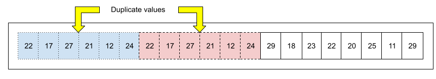
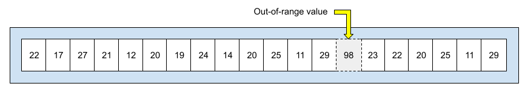

# 数据处理-清洗

作为一名机器学习工程师，你也会花费大量时间来剔除坏样本，并清理还能用的样本。即使只有几个坏苹果，也足以破坏一个庞大的数据集。
数据集中的许多示例由于以下一个或多个问题而不可靠：

| Problem category 问题类别 | Example 例子 |
|---|---|
| Omitted values 省略值 | A census taker fails to record a resident's age.<br>人口普查员漏录了一位居民的年龄。 |
| Duplicate examples 重复示例 | A server uploads the same logs twice.<br>服务器上传了两次相同的日志。 |
| Out-of-range feature values 特征值超出范围 | A human accidentally types an extra digit.<br>人不小心多输入了一个数字。 |
| Bad labels 糟糕的标签 | A human evaluator mislabels a picture of an oak tree as a maple.<br>人工评估员将一张橡树图片误标为枫树。 |


You can write a program or script to detect any of the following problems:
您可以编写程序或脚本来检测以下任何问题：
- Omitted values  省略值
- Duplicate examples  重复示例
- Out-of-range feature values
- 超出范围的特征值

例如，以下数据集包含六个重复值：


再举一个例子，假设某个功能的温度范围必须在 10 到 30 度之间（含 10 度和 30 度）。但意外总会发生——比如温度计暂时暴露在阳光下，导致出现异常值。你的程序或脚本必须能够识别小于 10 度或大于 30 度的温度值：


当标签由多人生成时，我们建议通过统计方法确定每位评分者生成的标签集是否等效。或许某位评分者的评分标准比其他评分者更严格，或者使用了不同的评分标准？

一旦检测到不良特征，通常需要“修复”包含不良特征的示例。 或者通过从数据集中删除错误标签或填充其值来修正错误标签。 详情请参见 数据特征 该部分 数据集、泛化和过拟合 模块。

----
# 代码练习
本次练习主要围绕 pandas库来， 用芝加哥出租车数据集

---
# 检查

# info()函数

[info](https://blog.csdn.net/qq_40305043/article/details/104862499)
[文档](https://pandas.pydata.org/docs/reference/api/pandas.DataFrame.info.html)
info()打印有关 DataFrame 的信息，包括索引 dtype 和列、非 NA 值和内存使用情况。


```python
_csv =  Path("data/chicago_taxi_train.csv")
if not _csv.exists():
    _csv = Path("../data/chicago_taxi_train.csv")
chicago_taxi_dataset = pd.read_csv(_csv)

chicago_taxi_dataset.info()
# 查看数据情况
# <class 'pandas.core.frame.DataFrame'>
# RangeIndex: 31694 entries, 0 to 31693
# Data columns (total 18 columns):
# #   Column                  Non-Null Count  Dtype  
# ---  ------                  --------------  -----  
# 0   TRIP_START_TIMESTAMP    31694 non-null  object 
# 1   TRIP_END_TIMESTAMP      31694 non-null  object 
# 2   TRIP_START_HOUR         31694 non-null  float64
# 3   TRIP_SECONDS            31694 non-null  int64  
# 4   TRIP_MILES              31694 non-null  float64
# 5   TRIP_SPEED              31694 non-null  float64
# 6   PICKUP_CENSUS_TRACT     13259 non-null  float64
# 7   DROPOFF_CENSUS_TRACT    14023 non-null  float64
# 8   PICKUP_COMMUNITY_AREA   28477 non-null  float64
# 9   DROPOFF_COMMUNITY_AREA  28199 non-null  float64
# 10  FARE                    31694 non-null  float64
# 11  TIPS                    31694 non-null  float64
# 12  TIP_RATE                31694 non-null  float64
# 13  TOLLS                   31694 non-null  float64
# 14  EXTRAS                  31694 non-null  float64
# 15  TRIP_TOTAL              31694 non-null  float64
# 16  PAYMENT_TYPE            31694 non-null  object 
# 17  COMPANY                 31694 non-null  object 
# dtypes: float64(13), int64(1), object(4)
# memory usage: 4.4+ MB
```
可以看到，芝加哥出租车数据集中有31694条记录， 但是 `PICKUP_CENSUS_TRACT`, `DROPOFF_CENSUS_TRACT`, `PICKUP_COMMUNITY_AREA`, `DROPOFF_COMMUNITY_AREA`字段存在缺失值（NA）

# describe()函数
[describe](https://pandas.pydata.org/docs/reference/api/pandas.DataFrame.describe.html)

生成描述性统计数据。
这个函数不同于info函数， 他需要手动打印输出
```python
print(chicago_taxi_dataset.describe())
TRIP_START_HOUR  TRIP_SECONDS    TRIP_MILES    TRIP_SPEED  PICKUP_CENSUS_TRACT  DROPOFF_CENSUS_TRACT  ...          FARE          TIPS      TIP_RATE         TOLLS        EXTRAS    TRIP_TOTAL
count     31694.000000  31694.000000  31694.000000  31694.000000         1.325900e+04          1.402300e+04  ...  31694.000000  31694.000000  31694.000000  31694.000000  31694.000000  31694.000000
mean         14.185635   1319.796397      8.289463     20.256544         1.703153e+10          1.703140e+10  ...     23.905210      3.246130     12.965785      0.002744      2.410468     29.755053
std           5.159454    928.932873      7.265672     11.110390         3.827747e+05          3.408106e+05  ...     16.970022      4.284567     15.517765      0.164343      5.805087     23.145537
min           0.000000     60.000000      0.500000      4.000000         1.703102e+10          1.703101e+10  ...      3.250000      0.000000      0.000000      0.000000      0.000000      3.250000
25%          10.500000    548.000000      1.720000     11.000000         1.703108e+10          1.703108e+10  ...      9.000000      0.000000      0.000000      0.000000      0.000000     10.750000
50%          14.750000   1081.000000      5.920000     17.600000         1.703132e+10          1.703132e+10  ...     18.750000      2.000000     12.200000      0.000000      0.000000     21.700000
75%          18.000000   1888.000000     14.500000     27.500000         1.703198e+10          1.703184e+10  ...     38.750000      5.000000     20.800000      0.000000      4.000000     48.265000
max          23.750000   7140.000000     68.120000     64.800000         1.703198e+10          1.703198e+10  ...    159.250000     60.000000    648.600000     27.000000     85.000000    248.500000

[8 rows x 14 columns]

```

打印包括， 数据个数， 平均值， 最大最小值， std标准差， 分位数

>可以看到TIP_RATE小费率平均是12.965785， 最大值居然是648， 有人在玩原神？
> 唉？ 云朵， 哒哒哒哒哒， 好想玩原神， 云原神！ 哒哒哒哒哒，看精彩纷纷， 云原神！
> 呜呜呜呜呜， 好想玩原神， 云原神！朋友已就位， 一起玩原神， 云原神！
> aaaaa，好想玩原神， 云原神！
> hahahahah，一起玩原神， 云原神！
> 好好好好想，好想玩玩原神
> 网页云端低功耗不失真
> wifi网线， 都可以60帧
> 来来来来， 来进入云原神
> 唉， 等等我呀

最大值648的小费可能是异常值， 可以留意一下， 但是如果是小费的话， 芝加哥也有很多有钱人吧
先调查，再决定要不要删除。 这才是数据清洗的核心。

# isna()函数
[isna](https://pandas.pydata.org/docs/reference/api/pandas.DataFrame.isna.html)
检测缺失值
显示序列中哪些条目为 NA。
```python
print(chicago_taxi_dataset.isna())

                TRIP_START_TIMESTAMP  TRIP_END_TIMESTAMP  TRIP_START_HOUR  TRIP_SECONDS  TRIP_MILES  TRIP_SPEED  PICKUP_CENSUS_TRACT  ...   TIPS  TIP_RATE  TOLLS  EXTRAS  TRIP_TOTAL  PAYMENT_TYPE  COMPANY
0                     False               False            False         False       False       False                 True  ...  False     False  False   False       False         False    False
1                     False               False            False         False       False       False                 True  ...  False     False  False   False       False         False    False
2                     False               False            False         False       False       False                False  ...  False     False  False   False       False         False    False
3                     False               False            False         False       False       False                False  ...  False     False  False   False       False         False    False
4                     False               False            False         False       False       False                False  ...  False     False  False   False       False         False    False
...                     ...                 ...              ...           ...         ...         ...                  ...  ...    ...       ...    ...     ...         ...           ...      ...
31689                 False               False            False         False       False       False                 True  ...  False     False  False   False       False         False    False
31690                 False               False            False         False       False       False                 True  ...  False     False  False   False       False         False    False
31691                 False               False            False         False       False       False                 True  ...  False     False  False   False       False         False    False
31692                 False               False            False         False       False       False                 True  ...  False     False  False   False       False         False    False
31693                 False               False            False         False       False       False                False  ...  False     False  False   False       False         False    False

[31694 rows x 18 columns]

```

可以看到PICKUP_CENSUS_TRACT确实有为Nan的数据
但是这个数据太详细看着有点费劲， 他的sum方法更方便
```python
print(chicago_taxi_dataset.isna().sum())
TRIP_SPEED                    0
PICKUP_CENSUS_TRACT       18435
DROPOFF_CENSUS_TRACT      17671
PICKUP_COMMUNITY_AREA      3217
DROPOFF_COMMUNITY_AREA     3495
FARE                          0
TIPS                          0
TIP_RATE                      0
TOLLS                         0
EXTRAS                        0
TRIP_TOTAL                    0
PAYMENT_TYPE                  0
COMPANY                       0
dtype: int64
```

# duplicated()函数
[duplicated](https://pandas.pydata.org/docs/reference/api/pandas.DataFrame.duplicated.html)
检查是否存在重复行
```python
print(chicago_taxi_dataset.duplicated().sum())
>> 0
```
居然没有， 唉


# quantile()函数
[quantile](https://pandas.pydata.org/docs/reference/api/pandas.DataFrame.quantile.html)
[quantile csdn](https://blog.csdn.net/mingqinsky/article/details/135934693)
返回指定轴上给定分位数的值。

##### 啥是分位数啊
[分位数](https://baike.baidu.com/item/%E5%88%86%E4%BD%8D%E6%95%B0/10064158)
```python
print(chicago_taxi_dataset.quantile(numeric_only=True, q=0.25))
TRIP_SECONDS              5.480000e+02
TRIP_MILES                1.720000e+00
TRIP_SPEED                1.100000e+01
PICKUP_CENSUS_TRACT       1.703108e+10
DROPOFF_CENSUS_TRACT      1.703108e+10
PICKUP_COMMUNITY_AREA     8.000000e+00
DROPOFF_COMMUNITY_AREA    8.000000e+00
FARE                      9.000000e+00
TIPS                      0.000000e+00
TIP_RATE                  0.000000e+00
TOLLS                     0.000000e+00
EXTRAS                    0.000000e+00
TRIP_TOTAL                1.075000e+01
Name: 0.25, dtype: float64
```

# 处理数据
# dropna()函数
[dropna](https://pandas.pydata.org/docs/reference/api/pandas.DataFrame.dropna.html)

删除缺失值
之前检查到 `PICKUP_CENSUS_TRACT 上车地点人口普查区编号`, `DROPOFF_CENSUS_TRACT下车地点人口普查区编号`, `PICKUP_COMMUNITY_AREA上车地点社区区域编号`, `DROPOFF_COMMUNITY_AREA下车地点社区区域编号`四个字段都有缺失值， 可以选择留在后面补一下， 或者删了
dropna()函数的 how参数提供两种删除方式
- ”any“：如果存在任何 NA 值，则删除该行或列。
- “all"：如果所有值均为 NA，则删除该行或该列。
```python
chicago_taxi_dataset = chicago_taxi_dataset.dropna(how="any")
```

# fillna()函数
[fillna](https://pandas.pydata.org/docs/reference/api/pandas.DataFrame.fillna.html)
此方法将缺失值替换为指定值。
```python
# 将所有 NaN 元素替换为 0。
chicago_taxi_dataset = chicago_taxi_dataset.fillna(0)
```

```python
# 将列“PICKUP_CENSUS_TRACT”、“DROPOFF_CENSUS_TRACT”中的所有 NaN 元素分别替换为 0、1。
values = {"PICKUP_CENSUS_TRACT": 0, "DROPOFF_CENSUS_TRACT": 1}
chicago_taxi_dataset = chicago_taxi_dataset.fillna(value=values)
```


# drop_duplicates()函数
[drop_duplicates](https://pandas.pydata.org/docs/reference/api/pandas.DataFrame.drop_duplicates.html)
用于删除重复行的函数。

```python
chicago_taxi_dataset = chicago_taxi_dataset.drop_duplicates()
```
