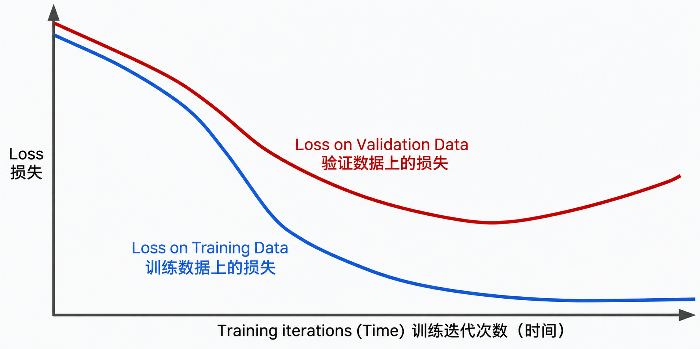

# 泛化和过拟合
想象一下， 您是一位来自遥远星系的访客， 您期待着观光并结识新朋友。但您不会说当地语言， 而您的翻译app也帮不上什么大忙。
您想知道自己该如何交流？
然后您有了一个主意。
您找到一个繁忙的当地社区， 并花了几个月时间倾听， 以便能跟着母语者学习这门语言。

在沉浸于该语言几个月之后，您终于觉得自己准备好交流了。
然而，当您真正尝试与其他当地人交流时，却发现对方根本听不懂您说的话，您也难以理解他们。
显然，您的语言能力并没有想象中那么好。您学到的语言知识无法很好地应用到新的交流场景中。

机器学习模型也可能出现同样的问题，当您根据数据训练模型时， 您是在教他在特定数据集上表现良好，但是这些训练数据只是真实数据的一小部分， 如果模型基于训练数据作出高质量预测，但基于全新数据做出的预测质量低得多，那么该模型就没有实现 <mark>泛化</mark> 。
在这种情况下， 我们说该模型对训练数据<mark>过度拟合</mark>了， 模型过度贴合训练数据中的特定模式，甚至记住了其中的噪声，因此无法很好地处理新数据。 很明显， 他无法识别新数据的模式。

当您意识到自己对一小群人的语言模式存在过度拟合的错误时， 您重新开始了语言学习。但这一次， 您扩展了自己的方法， 并聆听众多不同说话者的声音，您的沟通能力现在可以成功的推广到全新的情境中。并且您获得了一份令人兴奋的新工作， 您可以将您的知识传授给他人。

----
泛化是指良好的模型能够对新数据做出良好预测。你的目标是创建一个对新数据具有良好泛化能力的模型。

过拟合是指创建的模型与训练集匹配（记忆）得过于紧密，以至于模型无法对新数据做出正确预测。过拟合的模型类似于一项在实验室中表现良好，但在现实世界中毫无价值的发明。
>提示：过拟合是机器学习中的常见问题，而非学术上的假设情形。

拟合， 就是模型必须能够对新数据做出良好预测。

---

以下曲线有助于你检测过拟合：
- loss curves  损失曲线
- generalization curves  泛化曲线
损失曲线绘制的是模型损失随训练迭代次数变化的情况。包含两条或更多损失曲线的图称为泛化曲线。以下泛化曲线展示了两条损失曲线：

两条损失曲线起初表现相似，随后出现分化。也就是说，经过一定次数的迭代后，训练集的损失下降或保持稳定（收敛），但验证集的损失却上升了。这表明存在过拟合。
相比之下，拟合良好的模型的泛化曲线会显示两条形状相似的损失曲线。

## 过拟合的原因是什么？
从广义上讲，过拟合是由以下一个或两个问题引起的：
- 训练集未能充分代表现实生活中的数据（或验证集、测试集）。
- 模型过于复杂。

## 泛化条件
模型在训练集上进行训练，但衡量模型价值的真正标准是它对新样本——尤其是现实世界数据——的预测表现。在开发模型时，测试集充当现实世界数据的替代品。训练一个泛化良好的模型意味着满足以下数据集条件：
- 样本必须独立同分布，这是一种更正式的说法，即样本之间不能相互影响。
- 数据集是平稳的，即数据集不会随时间发生显著变化。
- 数据集的各个划分具有相同的分布。也就是说，训练集中的样本在统计上与验证集、测试集以及现实世界数据中的样本相似。
