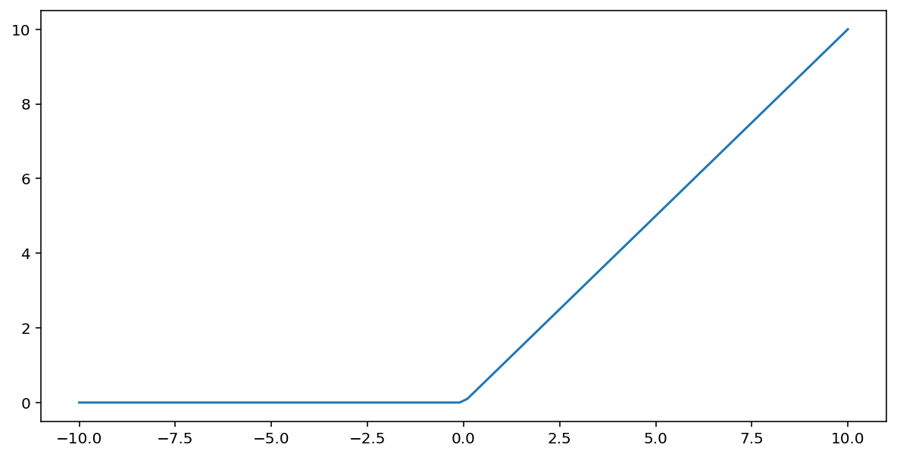
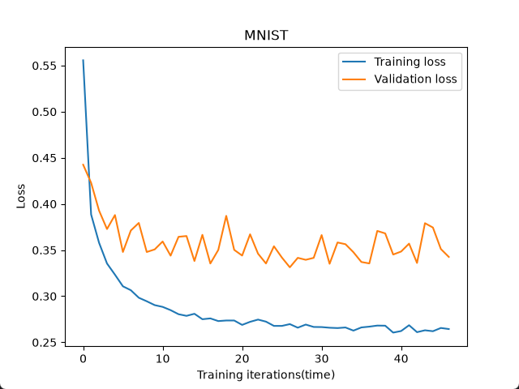

为了解决线性不可分的问题， 以及为了让模型可以解决更复杂的问题， 于是我们开始学习使用神经网络，之前看到的逻辑回归模型也可以看作一种简单的神经网络。

## 节点与隐藏层
在神经网络术语中，输入层和输出层之间的附加层被称为隐藏层，这些层中的节点被称为神经元。添加隐藏层和神经元可以让模型变得非常复杂， 这样它就可以拟合更复杂的数据， 不断的增加隐藏层可以做到大力出奇迹， 但隐藏层和神经元不是越多越好， 这会带来过拟合的风险

> 要注意一点， 单纯的加入隐藏层和神经元不会让模型变得非线性， 需要加入非线性的激活函数，例如之前在逻辑回归中使用的 Sigmoid 函数。

## 常见激活函数
常用作激活函数的三种数学函数是 sigmoid、tanh 和 ReLU。

sigmoid 之前讨论过， 他是一个s型曲线， 常用于在二分类时把输出映射在0-1。

tanh（双曲正切函数）和sigmoid差不多， 他是把范围映射在-1到1

ReLU （是线性整流函数）和上面两个函数不太一样， 首先他看起来就不平滑，但它在神经网络训练过程中不太容易受到梯度消失问题的影响， 其次他的计算也比较简单。 相比于 Sigmoid 函数，ReLU 通常更容易训练深层神经网络，而且计算比较简单。


# 多类别分类
以下例子指的是多类别分类模型：
- 这只狗是比格犬、巴吉度猎犬还是寻血猎犬？
- 这朵花是西伯利亚鸢尾、荷兰鸢尾、蓝旗鸢尾还是矮须鸢尾？
- 那架飞机是波音 747、空客 320、波音 777 还是巴西航空工业 190？
- 这是一张苹果、熊、糖果、狗还是鸡蛋的图片？

和之前的二分类不同，多类别分类需要预测多个类别的概率。之前在二分类中使用 Sigmoid 函数来输出概率，这次使用 Softmax 函数，它可以将多个输出转换为概率，并且这些概率的总和为 1。

---
# 代码部分
既然Google使用的是图像， 我也用图像训练
我使用Fashion-MNIST 服饰图像分类数据集， 他可以用PyTorch 直接加载
完整代码[fashion_mnist_torch.py](fashion_mnist_torch.py)

```python
import matplotlib.pyplot as plt
from torchvision import datasets, transforms
import torch


def target_transform(y: int) -> torch.Tensor:
    return torch.nn.functional.one_hot(
        torch.tensor(y, dtype=torch.int64),
        num_classes=10
    ).float()

if __name__ == "__main__":


    transform = transforms.ToTensor()

    train_dataset = datasets.FashionMNIST(
        root="./data",
        train=True,
        download=True,
        transform=transform,
        target_transform=target_transform
    )

    test_dataset = datasets.FashionMNIST(
        root="./data",
        train=False,
        download=True,
        transform=transform,
        target_transform=target_transform
    )

    plt.imshow(train_dataset[1][0].squeeze(), cmap=plt.cm.binary)
    plt.show()
```

transforms.ToTensor() 是 torchvision 提供的一个图片转换工具， 将 PIL 图像或 ndarray 转换为张量，并相应地缩放数值， 注意他会缩放数值， 这样他可以不用归一化了， 但不是所有情况下都会返回归一化数值。参考文档：
>https://docs.pytorch.org/vision/stable/generated/torchvision.transforms.ToTensor.html
```python
transform = transforms.ToTensor()
```

FashionMNIST是用来加载和访问 Fashion-MNIST 数据集， 可以选择训练集和测试集， 通过transform参数传入的工具把图像像素缩放到0-1

```python
def target_transform(y: int) -> torch.Tensor:
    return torch.nn.functional.one_hot(
        torch.tensor(y, dtype=torch.int64),
        num_classes=10
    ).float()
```
这个target_transform是把标签处理为独热编码

----
现在的数据是训练集有60000个数据， 图片大小是28x28。需要在神经网络中展平为784维用来训练。有 10 个类别的标签，所以要输出10个， 之前把标签处理为独热编码是为了把标签处理成10维

下面是创建简单神经网络的代码
```python
class FashionClassifier(torch.nn.Module):
    def __init__(self, *args: Any, **kwargs: Any):
        super().__init__(*args, **kwargs)

        self.network = torch.nn.Sequential(
            torch.nn.Flatten(),

            torch.nn.Linear(in_features=784, out_features=256),
            torch.nn.ReLU(),

            torch.nn.Linear(in_features=256, out_features=256),
            torch.nn.ReLU(),

            torch.nn.Linear(in_features=256, out_features=256),
            torch.nn.ReLU(),

            torch.nn.Linear(in_features=256, out_features=128),
            torch.nn.ReLU(),

            torch.nn.Linear(in_features=128, out_features=10),
        )

    def forward(self, x):
        # 前向传播
        return self.network(x)
```
这个模型有 4 个隐藏层，神经元数量分别是 256、256、256、128，主打的就是力大砖飞。

损失函数这里， 我可以用 BCEWithLogitsLoss 或 CrossEntropyLoss ， 他们的区别是BCEWithLogitsLoss 内部结合了 Sigmoid 和 Binary Cross Entropy，
而 CrossEntropyLoss 内部结合了 LogSoftmax 和 NLLLoss。由于这次是单标签多类别分类，所以我使用 CrossEntropyLoss。
```python
# 损失函数
loss_fn = torch.nn.CrossEntropyLoss()    
```

优化器使用AdamW， 因为这次学习没有学优化器
```python
# 优化器
_optimizer = torch.optim.AdamW(
    _model.parameters(),  # 需要优化的模型参数
    lr=_learning_rate,  # 学习率
    betas=(0.9, 0.999),  # 一阶与二阶动量的衰减系数
    eps=1e-8,  # 防止除零的小常数
            weight_decay=1e-2  # 权重衰减（AdamW为解耦方式）
)
```

训练部分和其他一样， 训练部分和其他一样， 神经网络也看loss损失， 但是只看这个， 但是这个还是太单调  

按照 MNIST数据提供的标签来 检查预测是否准确

| Label | Description（类别名称）  |
| ----- | ------------------ |
| 0     | T-shirt/top（T恤/上衣） |
| 1     | Trouser（裤子）        |
| 2     | Pullover（套头衫）      |
| 3     | Dress（连衣裙）         |
| 4     | Coat（外套）           |
| 5     | Sandal（凉鞋）         |
| 6     | Shirt（衬衫）          |
| 7     | Sneaker（运动鞋）       |
| 8     | Bag（包）             |
| 9     | Ankle boot（短靴）     |


我用下面的代码来打印模型预测的结果
```python
_model.eval()
with torch.no_grad():
    for X, y in test_loader:
        X = X.to(_device)
        y = y.to(_device)
        pred = _model(X)
        pred = torch.nn.functional.softmax(pred, dim=1)

        for probabilities in pred:

            predicted = probabilities.argmax().item()

            print(f"Sum: {probabilities.sum().item():.4f}")
            print("-" * 30)


        break
```

经过 Softmax 处理后，得到的是各个类别的概率，需要从多个类别的概率中选择一个最高值。argmax()函数 可以找到最大值对应的索引，再通过这个索引获取对应的类别标签。
```python
class_names = [
    "T-shirt/top", "Trouser", "Pullover", "Dress", "Coat",
    "Sandal", "Shirt", "Sneaker", "Bag", "Ankle boot"
]

_model.eval()
with torch.no_grad():
    for X, y in test_loader:
        X = X.to(_device)
        y = y.to(_device)
        pred = _model(X)
        pred = torch.nn.functional.softmax(pred, dim=1)

        for probabilities, _y in zip(pred, y):
            for name, p in zip(class_names, probabilities):
                print(f"{name:<15}: {p.item():.4f}")

            predicted = probabilities.argmax().item()
            true_label = _y.argmax().item()

            print(f"Sum: {probabilities.sum().item():.4f}")
            print(f"预测结果：{class_names[predicted]}")
            print(f"真实结果  {class_names[true_label]}")
            print("-" * 30)
        break
```

看结果挺不错的， 准确率还是比较高的
```
------------------------------
T-shirt/top    : 0.0038
Trouser        : 0.0000
Pullover       : 0.8318
Dress          : 0.0001
Coat           : 0.1040
Sandal         : 0.0000
Shirt          : 0.0600
Sneaker        : 0.0000
Bag            : 0.0002
Ankle boot     : 0.0000
Sum: 1.0000
预测结果：Pullover
真实结果  Coat
------------------------------
T-shirt/top    : 0.0001
Trouser        : 0.0000
Pullover       : 0.0000
Dress          : 0.0002
Coat           : 0.0005
Sandal         : 0.0000
Shirt          : 0.0001
Sneaker        : 0.0000
Bag            : 0.9989
Ankle boot     : 0.0000
Sum: 1.0000
预测结果：Bag
真实结果  Bag
------------------------------
T-shirt/top    : 0.0001
Trouser        : 0.0000
Pullover       : 0.0001
Dress          : 0.0001
Coat           : 0.0000
Sandal         : 0.9981
Shirt          : 0.0001
Sneaker        : 0.0009
Bag            : 0.0000
Ankle boot     : 0.0005
Sum: 1.0000
预测结果：Sandal
真实结果  Sandal
------------------------------
```


