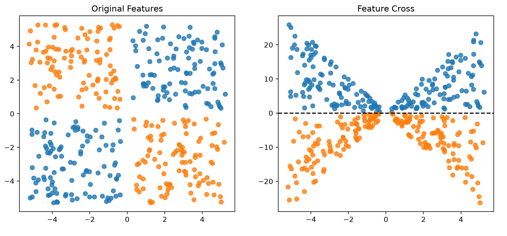

# 类别数据处理-特征交叉

**特征交叉（Feature Crosses）** 是通过对数据集中的两个或多个类别特征或分桶后的特征进行组合（即计算笛卡尔积）而构造的新特征。

与**多项式变换（Polynomial Transforms）** 类似，特征交叉使线性模型能够处理非线性关系。此外，特征交叉还可以表示不同特征之间的交互作用。
>也是增加输入特征的一种方式, 和多项式变换的区别是这个是对两个或多个变换的


看完Google的[特征交叉练习](https://developers.google.com/machine-learning/crash-course/categorical-data/feature-cross-exercises)， 感觉完全没有练习到， 完全没有任何用

https://zhuanlan.zhihu.com/p/618399610

## 特征交叉主要有两大类：1) 显示交叉；2) 隐式交叉
我这里只看显示交叉
例如，考虑一个具有以下类别特征的叶子数据集：
edges叶片边缘的形态特征 ，包含 smooth平滑 、 toothed锯齿状 和 lobed分裂状 
arrangement叶片在茎上的排列方式 ，包含 opposite对生 和 alternate互生 

假设上述顺序是独热表示中特征列的顺序，因此具有 smooth 边缘和 opposite 排列的叶子表示为 
`{(1, 0, 0), (1, 0)} 。`

这两个特征的交叉（或笛卡尔积）为：
>{Smooth_Opposite, Smooth_Alternate, Toothed_Opposite, Toothed_Alternate, Lobed_Opposite, Lobed_Alternate}


# 代码练习
我主要还是写代码练习， 首先数据是 让GPT老师参考 tensorflow playground 里数据集的代码， 生成了一个py
，用来导出csv
[generate_xor_data.py](generate_xor_data.py)

这是我训练的代码
[feature_cross.py](feature_cross.py)
根据GPT老师的数据， 现在已经有X1， 和X2两个特征输入了， 现在创建一个X3作为特征交叉的特征输入

```python
x3 = x1 * x2
```

把x1到3用matplotlib散点图绘制出来对比， 看看交叉特征是否能让这个数据从线形不可分到可分


这张图看起来在训练也没意思了， 也证明交叉特征可以解决这个问题， 下面我用更复杂的例子来练习

试试这个 [蘑菇](https://archive.ics.uci.edu/dataset/73/mushroom)

蘑菇数据集特征分为
菌盖：`cap-shape  菌盖形状`, `cap-color  菌盖颜色`, `cap-surface 菌盖表面`
菌褶:`gill-spacing 菌褶间距`， `gill-attachment 菌褶着生方式`, `gill-size 菌褶宽度`, `gill-color 菌褶颜色`
菌柄: `stalk-shape 菌柄形状`, `stalk-root  菌柄基部`, `stalk-surface-above-ring	菌环上方菌柄表面质地`, `stalk-surface-below-ring	菌环下方菌柄表面质地` `stalk-color-above-ring	菌环上方菌柄颜色`, `stalk-color-below-ring	菌环下方菌柄颜色` 
菌幕: `veil-type  菌幕类型`, `veil-color  菌幕颜色`
菌环: `ring-number	菌环数量`, `ring-type	菌环类型`

没有分类的特征有：`bruises  瘀伤`, `odor  气味`, `spore-print-color	孢子印颜色`, `population	菌群分布状况`, `habitat	生长环境（栖息地也可以）`


拿一个特征举例
菌盖 = `cap-shape  菌盖形状` * `cap-color  菌盖颜色` * `cap-surface 菌盖表面`

菌盖的三个特征均为类别特征（Categorical Features）。
本次实验选择先使用原始类别值构造交叉特征（Feature Cross），将菌盖形状、菌盖表面质地和菌盖颜色组合成一个新的类别特征。
由于交叉后的结果仍然是字符串类型，因此需要进一步进行独热编码（One-Hot Encoding），将其转换为数值特征，以便后续输入机器学习模型进行训练。 具体实现代码如下
```python
# 特征交叉
cap_cross = X["cap-shape"].astype(str) + "_" + X["cap-surface"] + "_" + X["cap-color"]

# 独热编码
# 创建一个包含分类变量的 Series
cap_encoder = OneHotEncoder()
# 学习规则
cap_encoder.fit(cap_cross.to_frame())
# 转换
cap_transformed = cap_encoder.transform(cap_cross.to_frame())
```
随着参与交叉的类别特征增多，特征维度可能迅速膨胀。

本次使用 Mushroom 数据集进行实验，对菌盖、菌褶、菌柄和菌环等类别特征分别进行了特征交叉，并使用独热编码将其转换为数值特征。

根据目前的实验统计，得到以下结果：

| 特征分组 | 原始特征编码维度 | 交叉特征编码维度 | 合计 |
|---|---:|---:|---:|
| 菌盖（Cap） | 20 | 90 | 110 |
| 菌褶（Gill） | 18 | 34 | 52 |
| 菌柄（Stalk） | 33 | 37 | 70 |
| 菌幕（Veil） | 4 | 不进行交叉 | 4 |
| 菌环（Ring） | 8 | 7 | 15 |
| **合计** | **83** | **168** | **251** |

仅这些特征就已经产生了 **251 维输入特征**，而数据集中还有其他尚未处理的类别特征。

实验过程中还发现，部分特征在数据集文档中定义了多个类别，但实际样本中只出现了其中一部分。例如，`veil-type` 虽然定义了两个类别，但实际数据中只有一个类别，属于常量特征。因此，包含它的 `veil_cross` 无法提供额外的交互信息，本次实验将其排除。

这说明特征交叉虽然能够表达多个特征之间的组合关系，但也可能显著增加输入维度，使特征更加稀疏，并带来额外的内存和计算开销，以及过拟合风险。

因此，在实际应用中，不应该盲目地对所有特征进行交叉，而应该根据特征之间的关系和模型表现，有选择地构造交叉特征。