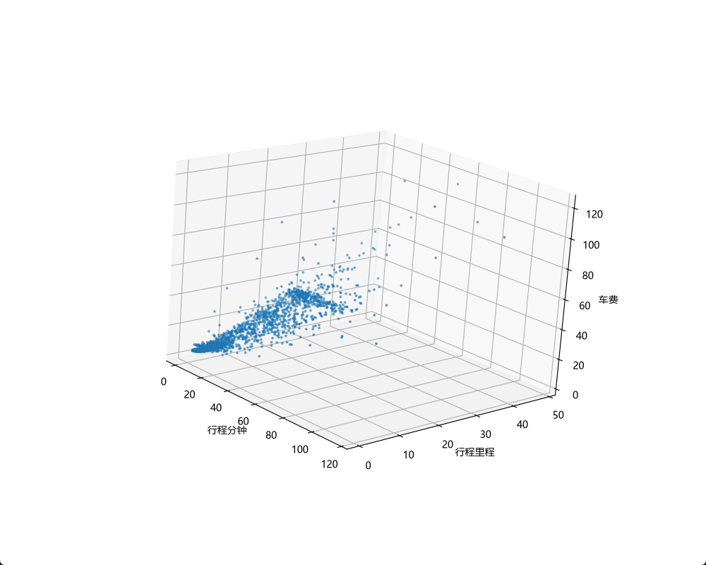
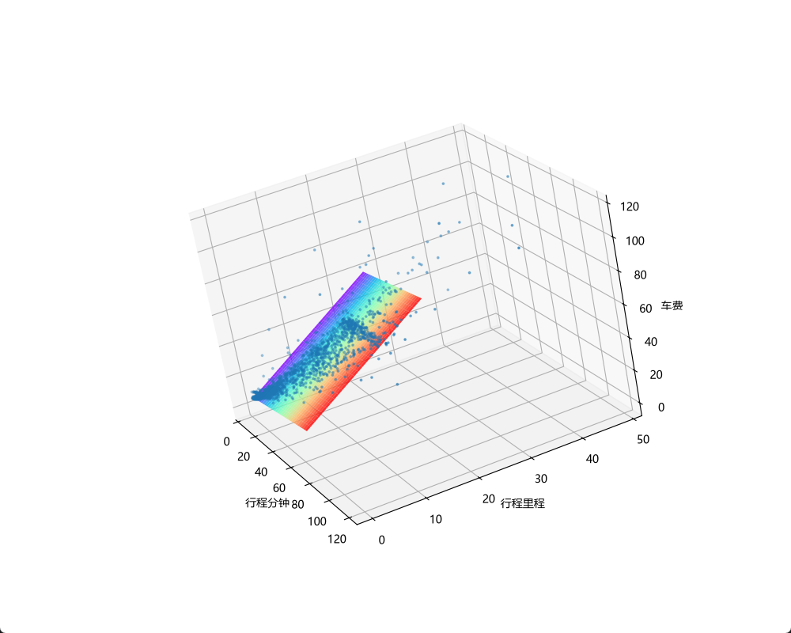

# 线性回归

本目录包含以下 PyTorch 练习：

- [lr_torch_1f.py](./lr_torch_1f.py)：使用行程里程预测车费。
- [lr_torch_2f.py](./lr_torch_2f.py)：使用行程里程和行程分钟数预测车费，训练前对输入进行标准化。
- [train_utils.py](./train_utils.py)：上述两个脚本使用的训练函数。
- [lr_torch_1f_onnx.py](./lr_torch_1f_onnx.py)：单特征模型训练、ONNX 导出与读取预测。

下面按单特征到双特征的顺序介绍线性回归。文中的双特征示例仅将秒转换为分钟；`lr_torch_2f.py` 还会进行标准化，并训练 50 轮。

线性回归是一种用于查找变量之间关系的统计技术。在机器学习背景下，线性回归用于查找特征与标签之间的关系。

以下这个例子是用行驶里程预测芝加哥出租车费 数据来自 [芝加哥市出租车行程数据集](https://www.google.com/url?q=https%3A%2F%2Fdata.cityofchicago.org%2FTransportation%2FTaxi-Trips%2Fwrvz-psew) 


| - - - - - - - - 行驶里程（英里） - - - - - - - - | - - - - - - - - 车费 - - - - - - - - |
| ---- | --- |
|  2.57    |  31.99   |
|    1.18  |     9.75 |
| 1.29     |  10.25   |
| 3.7      |  23.75   |
| 1.15     |  10      |
| 1.38     |  11      |
| 2        | 14.5     |
|...       |...       |

我们把这些数据读取并绘制在图表上
```python
import os
# 本机 OpenMP 重复加载问题的临时绕过设置，并未消除底层运行库冲突
os.environ["KMP_DUPLICATE_LIB_OK"] = "TRUE"

import torch
import pandas as pd
import matplotlib.pyplot as plt

chicago_taxi_dataset = pd.read_csv("https://download.mlcc.google.com/mledu-datasets/chicago_taxi_train.csv")

# TRIP_MILES  行程里程
# TRIP_SECONDS 行程时长（秒）
# FARE 票价
# COMPANY  公司
# PAYMENT_TYPE  支付方式
# TIP_RATE 小费
_training_df:pd.Series | pd.DataFrame = chicago_taxi_dataset.loc[
    :, ('TRIP_MILES', 'TRIP_SECONDS', 'FARE', 'COMPANY', 'PAYMENT_TYPE', 'TIP_RATE')]

# 把 Pandas 数据转换成 PyTorch 的 Tensor（张量）。
# 输入特征 X：行程里程
_x:torch.Tensor = torch.tensor(_training_df[['TRIP_MILES']].values, dtype=torch.float)
# 真实标签 y：车费
_y:torch.Tensor = torch.tensor(_training_df[['FARE']].values, dtype=torch.float)

 # 按顺序查找可用字体，兼容 macOS 和 Windows
plt.rcParams["font.sans-serif"] = [
    "Microsoft YaHei",  # Windows：微软雅黑
    "PingFang SC",      # macOS：苹方
    "Heiti SC",         # macOS：黑体
    "SimHei",          # Windows：黑体
    "DejaVu Sans",
]

# 避免部分中文字体无法显示负号
plt.rcParams["axes.unicode_minus"] = False
    # 配置图像
plt.title("行驶里程与车费", fontsize=14)  # 设置图像名称
plt.xlabel("行程里程")  # 设置横坐标的名称
plt.ylabel("车费")  # 设置纵坐标的名称


plt.scatter(_x, _y, s=10, alpha=0.3)
plt.show()
```


从散点图可以看出，行驶里程越远，车费总体上越高，两者呈现明显的正相关关系。虽然部分数据点偏离了整体趋势，这里仍仅使用行驶里程作为输入特征，学习它与车费之间的线性关系。

为了拟合行驶里程与车费之间的关系，我们希望找到一条能够反映数据整体趋势、使预测误差尽可能小的直线：


直线可以用公式 车费 = 权重 × 行驶里程 + 偏置 表示。但我们还不知道权重和偏置应该是多少，因此需要创建一个线性回归模型来表示这个关系，再通过训练从数据中学习这两个参数。

这里使用行驶里程预测车费，所以模型只有 1 个输入特征和 1 个输出值：
```Python
import torch
model = torch.nn.Linear(in_features=1, out_features=1)
```

#### 损失函数
在训练过程中，怎么判断这条线拟合得好不好？

我们可以使用损失函数，用一个数值衡量预测车费与真实车费之间的差距。损失越小，说明模型在这个指标下拟合得越好。

线性回归中常见的损失和误差指标包括：`L1 loss`、`平均绝对误差（MAE`）、`L2 loss、均方误差（MSE）`和`均方根误差（RMSE)`。

这里使用 `L1 loss`，将预测车费与真实车费之差的绝对值相加：

```python
# L1 loss：绝对误差之和
loss_fn = torch.nn.L1Loss(reduction="sum")
```

#### 梯度下降法
有了损失函数，我们就能衡量模型的预测效果。但怎样调整权重和偏置，才能让损失减小呢？

梯度下降是一种通过反复调整模型参数，寻找较小损失的方法。梯度指向损失增大最快的方向，因此我们沿着梯度的反方向，小步更新参数。学习率控制每次更新的步幅。

模型先初始化权重和偏置，再重复以下步骤：
1. 使用当前权重和偏置计算预测值，并计算损失。
2. 计算损失对权重和偏置的梯度。
3. 根据梯度和学习率，沿着降低损失的方向更新参数。
4. 重复以上过程，直到达到设定的训练轮数，或满足提前停止条件。

#### 超参数
超参数是控制训练各个方面的变量。三个常见的超参数是：
- Learning rate  学习率
- Batch size  批量大小
- Epochs  训练轮数
```python
# 训练轮数
epochs = 20
# 批量大小
batch_size = 50
# 学习率
learning_rate = 0.001
```
#### Learning rate  学习率
**学习率（Learning rate）** 是控制每次参数更新步幅的超参数，会影响模型的收敛速度和训练稳定性。学习率太小，参数更新缓慢，可能需要更长时间才能收敛；学习率太大，可能反复越过损失较小的位置，导致损失震荡，甚至发散。选择合适的学习率，有助于模型更快、更稳定地降低损失。

#### Batch size  批量大小
批量大小（Batch size）指的是每次更新模型参数时使用的数据量。例如，批量大小为 50，就是每次用 50 个样本计算损失和梯度，然后更新一次权重和偏置。

每次更新参数，不一定要用全部训练数据来计算梯度。我们可以随机使用一个样本，或者一小批样本来估计整体梯度，这分别对应`随机梯度下降法 (SGD) `和`小批量随机梯度下降`

#### 随机梯度下降法 (SGD) 
随机梯度下降法 (SGD)  在 PyTorch 和 Keras 中，SGD 都是优化器的名称，负责根据梯度更新参数。
```python
optimizer = torch.optim.SGD(model.parameters(), lr=learning_rate)
```

#### Epochs  训练轮数
训练通常需要很多轮。也就是说，系统需要多次处理训练集中的每个样本。

#### 准备训练数据
训练之前，需要先准备数据。下面将行驶里程和车费转换成 PyTorch 使用的数据格式，再把它们配对，按批次提供给模型。
```python
import torch
from torch.utils.data import TensorDataset, DataLoader
# 把 Pandas 数据转换成 PyTorch 的 Tensor（张量）。
# 输入特征 X：行程里程
x:torch.Tensor = torch.tensor(training_df[['TRIP_MILES']].values, dtype=torch.float)
# 真实标签 y：车费
y:torch.Tensor = torch.tensor(training_df[['FARE']].values, dtype=torch.float)

# 训练数据集
dataset = TensorDataset(x, y)

# 创建数据加载器
# 假设你有 200 条训练数据，而模型每次只需要处理 50 条。
# DataLoader 就可以把数据分成 4 个 Batch（批次），让训练循环依次获取。
train_load = DataLoader(
    dataset,
    batch_size=batch_size,
    shuffle=True
    )
```


#### 前面介绍了梯度下降的原理，下面使用 PyTorch 展示模型如何按批次更新权重和偏置，并在每轮训练结束后计算训练集的平均损失。
```python
for epoch in range(epochs):
    model.train()

    for batch_x, batch_y in train_load:
        # 1. 前向传播
        prediction = model(batch_x)
        # 2. 计算 Loss
        loss = loss_fn(prediction, batch_y)

        # 3. 清空梯度
        optimizer.zero_grad()

        # 4. 反向传播
        loss.backward()

        # 5. 更新参数
        optimizer.step()
    
    # 把模型切换到评估模式（Evaluation Mode）。
    model.eval()

    # 关闭梯度记录
    with torch.no_grad():
        epoch_loss = 0

        for eval_x, eval_y in train_load:
            # 本例暂不划分数据集，直接计算模型在训练集上的平均损失
            predictions = model(eval_x)

            batch_loss = loss_fn(predictions, eval_y)
            epoch_loss += batch_loss.item()

        # 循环结束后，计算每个样本的平均损失
        epoch_loss = epoch_loss / len(train_load.dataset)
        print(f"epoch: {epoch+1}/{epochs}, loss: {epoch_loss:.4f}")

```
这里使用 `L1Loss(reduction="sum")`，损失函数已经计算了当前批次中所有样本的绝对误差之和。因此，每轮训练结束后，只需要重新计算并累加各批次的损失，再除以训练集的总样本数，就能得到当前模型在训练集上的平均绝对误差（MAE）。


## 完整示例

下面将数据读取、模型创建、训练和拟合线绘制组合起来。运行代码后，可以看到每轮训练的平均损失，以及最终的拟合直线。
```python
# 本例在 Python 3.13 环境下测试，使用 PyTorch 进行模型训练，pandas 读取数据，Matplotlib 绘制图表。
import os
# 本机 OpenMP 重复加载问题的临时绕过设置，并未消除底层运行库冲突
os.environ["KMP_DUPLICATE_LIB_OK"] = "TRUE"

import torch
import pandas as pd
import matplotlib.pyplot as plt
from torch.utils.data import TensorDataset, DataLoader

# 随机种子， 42 是“生命、宇宙以及一切的终极答案”。
torch.manual_seed(42)

# 超参数
# 训练轮数
epochs = 20
# 批量大小
batch_size = 50
# 学习率
learning_rate = 0.001

# 读取数据集
chicago_taxi_dataset = pd.read_csv("https://download.mlcc.google.com/mledu-datasets/chicago_taxi_train.csv")

# TRIP_MILES  行程里程
# TRIP_SECONDS 行程时长（秒）
# FARE 票价
# COMPANY  公司
# PAYMENT_TYPE  支付方式
# TIP_RATE 小费
training_df:pd.Series | pd.DataFrame = chicago_taxi_dataset.loc[
    :, ('TRIP_MILES', 'TRIP_SECONDS', 'FARE', 'COMPANY', 'PAYMENT_TYPE', 'TIP_RATE')]

# 把 Pandas 数据转换成 PyTorch 的 Tensor（张量）。
# 输入特征 X：行程里程
x:torch.Tensor = torch.tensor(training_df[['TRIP_MILES']].values, dtype=torch.float)
# 真实标签 y：车费
y:torch.Tensor = torch.tensor(training_df[['FARE']].values, dtype=torch.float)

# 训练数据集
dataset = TensorDataset(x, y)
# 创建数据加载器
# 假设你有 200 条训练数据，而模型每次只需要处理 50 条。
# DataLoader 就可以把数据分成 4 个 Batch（批次），让训练循环依次获取。
train_load = DataLoader(
    dataset,
    batch_size=batch_size,
    shuffle=True
    )

# 损失函数
# L1 loss：绝对误差之和
loss_fn = torch.nn.L1Loss(reduction="sum")

# 创建模型
model = torch.nn.Linear(in_features=1, out_features=1)

# 优化器
optimizer = torch.optim.SGD(model.parameters(), lr=learning_rate)

for epoch in range(epochs):
    model.train()

    for batch_x, batch_y in train_load:
        # 1. 前向传播
        prediction = model(batch_x)
        # 2. 计算 Loss
        loss = loss_fn(prediction, batch_y)

        # 3. 清空梯度
        optimizer.zero_grad()

        # 4. 反向传播
        loss.backward()

        # 5. 更新参数
        optimizer.step()

        # 把模型切换到评估模式（Evaluation Mode）。
    model.eval()

    # 关闭梯度记录
    with torch.no_grad():

        epoch_loss = 0
        
        for eval_x, eval_y in train_load:
            # 本例暂不划分数据集，直接计算模型在训练集上的平均损失
            predictions = model(eval_x)

            batch_loss = loss_fn(predictions, eval_y)
            epoch_loss += batch_loss.item()

        # 循环结束后，计算每个样本的平均损失
        epoch_loss = epoch_loss / len(train_load.dataset)
        print(f"epoch: {epoch+1}/{epochs}, loss: {epoch_loss:.4f}")

w = model.weight.item()
b = model.bias.item()

#  下面是线性回归计算， y=b+wx
y_pre = b + w * x

# 按顺序查找可用字体，兼容 macOS 和 Windows
plt.rcParams["font.sans-serif"] = [
    "Microsoft YaHei",  # Windows：微软雅黑
    "PingFang SC",      # macOS：苹方
    "Heiti SC",         # macOS：黑体
    "SimHei",          # Windows：黑体
    "DejaVu Sans",
]

# 避免部分中文字体无法显示负号
plt.rcParams["axes.unicode_minus"] = False
    # 配置图像
plt.title("行驶里程与车费", fontsize=14)  # 设置图像名称
plt.xlabel("行程里程")  # 设置横坐标的名称
plt.ylabel("车费")  # 设置纵坐标的名称


plt.plot(x, y_pre, color="red")
plt.scatter(x, y, s=10, alpha=0.3)
plt.show()

```

模型已经学习到了行程里程与车费之间的整体关系，但部分样本的预测结果仍存在较大误差。

为了进一步改善预测效果，我们可以尝试增加一个输入特征，看看模型的表现是否有所提升。

这次，我们选择**行程时长（TRIP_SECONDS）**作为第二个输入特征，与之前的行程里程（TRIP_MILES）一起用于模型训练。

不过，在添加这个特征之前，我们需要先观察它的数据分布。
由于行程时长以秒为单位，数值范围可能远大于行程里程。如果直接用于训练，训练将需要更长的时间才能收敛，甚至可能完全无法收敛！
关于这个问题，可以参考 Google 机器学习速成课程中的
[归一化](https://developers.google.com/machine-learning/crash-course/numerical-data/normalization)

因此，我们先尝试对数据进行简单处理，将行程时长从秒转换为分钟，再将其加入模型。

| - - - - - - - - 行驶里程（英里） - - - - - - - - | 行程时长（秒） | 处理后 --行程时长（分） | - - - - - - - - 车费 - - - - - - - - |
| ---------------------------------------- | ------- | ------------- | ---------------------------------- |
| 2.57                                     | 2341    | 39            | 31.99                              |
| 1.18                                     | 1074    | 17.9          | 9.75                               |
| 1.29                                     | 1173    | 19.55         | 10.25                              |
| 3.7                                      | 3360    | 56            | 23.75                              |
| 1.15                                     | 1044    | 17.4          | 10                                 |
| 1.38                                     | 1251    | 20.85         | 11                                 |
| 2                                        | 1813    | 30.22         | 14.5                               |
| ...                                      | ...     | ...           | ...                                |

```python
training_df["TRIP_MINUTES"] = training_df["TRIP_SECONDS"] / 60
# 把 Pandas 数据转换成 PyTorch 的 Tensor（张量）。
# 输入特征 X：行程里程 , 行程时长（秒）
x: torch.Tensor = torch.tensor(training_df[['TRIP_MILES', "TRIP_MINUTES"]].values, dtype=torch.float)
# 真实标签 y：车费
y: torch.Tensor = torch.tensor(training_df[['FARE']].values, dtype=torch.float)
```

随着模型的输入特征从一个增加到两个，之前使用的二维散点图已经不太适合同时展示所有变量之间的关系。
因此，这次我们尝试使用**三维散点图（3D Scatter Plot）**进行可视化
```python
# 按顺序查找可用字体，兼容 macOS 和 Windows
plt.rcParams["font.sans-serif"] = [
    "Microsoft YaHei",  # Windows：微软雅黑
    "PingFang SC",      # macOS：苹方
    "Heiti SC",         # macOS：黑体
    "SimHei",          # Windows：黑体
    "DejaVu Sans",
]


# 创建画布，并添加三维坐标轴
fig = plt.figure(figsize=(10, 8))
ax = fig.add_subplot(111, projection="3d")

# # 设置观察角度，使用 Y-up 坐标系（Y 轴朝上）
ax.view_init(elev=25, azim=-60, vertical_axis="y")

# 从数据集中随机抽取最多 2000 条样本，避免散点过于密集
# 随机抽取最多 2000 条数据
plot_df = training_df.sample(
    n=min(2000, len(training_df)),
    random_state=42
)

# X：行程里程
plot_x = plot_df["TRIP_MILES"]

# Y：车费
plot_y = plot_df["FARE"]

# Z：行程时长（分）
plot_z = plot_df["TRIP_MINUTES"]

ax.set_xlabel("行程里程")
ax.set_ylabel("车费")
ax.set_zlabel("行程分钟")

# 绘制三维散点图
# s：散点大小
# alpha：透明度，范围为 0～1
ax.scatter(plot_x, plot_y, plot_z, s=3, alpha=0.8)

# 显示图表
plt.show()
```


接下来创建线性回归模型。
由于输入特征从原来的一个增加到了两个，因此需要将 in_features 从 1 修改为 2，而输出仍然是预测车费，所以 out_features 保持为 1。
```python
model = torch.nn.Linear(in_features=2, out_features=1)
```

这次我们也尝试更换优化器，使用 RMSprop 代替之前的 SGD，看看不同的优化器是否会对模型的训练效果产生影响。
```python
# 优化器
optimizer = torch.optim.RMSprop(model.parameters(), lr=learning_rate)
```

训练部分的代码不需要修改，仍然沿用之前的训练流程。虽然这次增加了一个输入特征，并更换了优化器，但整体训练过程保持不变。
不过，由于这次模型使用了两个输入特征，预测结果的可视化方式也需要相应调整。

之前我们使用二维图展示线性回归的预测直线，而现在可以在三维坐标系中使用一个平面来表示模型的预测结果，从而更直观地观察模型对数据的拟合情况。
```python
# 创建网格范围
# 分别在 X 轴（行程里程）和 Z 轴（行程时长）上取一组均匀分布的采样点
# 这里使用 1% ~ 99% 分位数，而不是最小值和最大值，
# 可以减少极端值对可视化范围的影响
x_range = np.linspace(
    np.percentile(plot_x, 1),
    np.percentile(plot_x, 99),
    30
)
z_range = np.linspace(
    np.percentile(plot_z, 1),
    np.percentile(plot_z, 99),
    30
)

# 根据 x_range 和 z_range 创建二维网格
# X 和 Z 的形状相同，表示平面上每一个采样点的坐标
X, Z = np.meshgrid(x_range, z_range)

# 将网格点整理成模型可输入的二维数组
# 每个网格点包含两个输入特征：[TRIP_MILES, TRIP_MINUTES]
grid = np.column_stack([X.ravel(), Z.ravel()])
# 转换为 PyTorch 张量，供模型预测使用
grid_tensor = torch.from_numpy(grid).float()

# 关闭梯度计算，仅进行前向预测
model.eval()
with torch.no_grad():
    # 对网格上的每个点进行预测，得到对应的车费
    # 再将结果调整回与 X、Z 相同的网格形状
    Y = model(grid_tensor).cpu().numpy().reshape(X.shape)

# 绘制预测平面
# X：行程里程
# Y：预测车费
# Z：行程时长
# cmap：颜色映射
# alpha：透明度
ax.plot_surface(X, Y, Z, cmap="rainbow", alpha=1)

```

完成训练后，我们将实际车费数据与模型预测得到的平面绘制在同一张三维图中，以便更直观地观察模型的拟合情况。



从图中可以观察散点与预测平面之间的差异，了解模型对数据整体趋势的拟合情况。
下面附上本次练习的完整代码。
```python
# 本例在 Python 3.13 环境下测试，使用 PyTorch 进行模型训练，pandas 读取数据，Matplotlib 绘制图表。
import os

# 本机 OpenMP 重复加载问题的临时绕过设置，并未消除底层运行库冲突
os.environ["KMP_DUPLICATE_LIB_OK"] = "TRUE"

import numpy as np
import torch
import pandas as pd
import matplotlib.pyplot as plt
from torch.utils.data import TensorDataset, DataLoader

# 随机种子， 42 是“生命、宇宙以及一切的终极答案”。
torch.manual_seed(42)

# 超参数
# 训练轮数
epochs = 20
# 批量大小
batch_size = 50
# 学习率
learning_rate = 0.001

# 读取数据集
chicago_taxi_dataset = pd.read_csv("https://download.mlcc.google.com/mledu-datasets/chicago_taxi_train.csv")

# TRIP_MILES  行程里程
# TRIP_SECONDS 行程时长（秒）
# FARE 票价
# COMPANY  公司
# PAYMENT_TYPE  支付方式
# TIP_RATE 小费
training_df: pd.DataFrame = chicago_taxi_dataset.loc[
    :, ('TRIP_MILES', 'TRIP_SECONDS', 'FARE', 'COMPANY', 'PAYMENT_TYPE', 'TIP_RATE')]


training_df["TRIP_MINUTES"] = training_df["TRIP_SECONDS"] / 60
# 把 Pandas 数据转换成 PyTorch 的 Tensor（张量）。
# 输入特征 X：行程里程 , 行程时长（分钟）
x: torch.Tensor = torch.tensor(training_df[['TRIP_MILES', "TRIP_MINUTES"]].values, dtype=torch.float)
# 真实标签 y：车费
y: torch.Tensor = torch.tensor(training_df[['FARE']].values, dtype=torch.float)

# 训练数据集
dataset = TensorDataset(x, y)
# 创建数据加载器
# 假设你有 200 条训练数据，而模型每次只需要处理 50 条。
# DataLoader 就可以把数据分成 4 个 Batch（批次），让训练循环依次获取。
train_load = DataLoader(
    dataset,
    batch_size=batch_size,
    shuffle=True
)

# 损失函数：计算当前 Batch 的绝对误差之和
loss_fn = torch.nn.L1Loss(reduction="sum")

# 创建模型
model = torch.nn.Linear(in_features=2, out_features=1)

# 优化器
optimizer = torch.optim.RMSprop(model.parameters(), lr=learning_rate)

for epoch in range(epochs):
    model.train()

    for batch_x, batch_y in train_load:
        # 1. 前向传播
        prediction = model(batch_x)
        # 2. 计算 Loss
        loss = loss_fn(prediction, batch_y)

        # 3. 清空梯度
        optimizer.zero_grad()

        # 4. 反向传播
        loss.backward()

        # 5. 更新参数
        optimizer.step()

        # 把模型切换到评估模式（Evaluation Mode）。
    model.eval()

    # 关闭梯度记录
    with torch.no_grad():

        epoch_loss = 0

        for eval_x, eval_y in train_load:
            # 本例暂不划分数据集，直接计算模型在训练集上的平均损失
            predictions = model(eval_x)

            batch_loss = loss_fn(predictions, eval_y)
            epoch_loss += batch_loss.item()

        # 循环结束后，计算每个样本的平均损失
        epoch_loss = epoch_loss / len(train_load.dataset)
        print(f"epoch: {epoch + 1}/{epochs}, loss: {epoch_loss:.4f}")

# 按顺序查找可用字体，兼容 macOS 和 Windows
plt.rcParams["font.sans-serif"] = [
    "Microsoft YaHei",  # Windows：微软雅黑
    "PingFang SC",      # macOS：苹方
    "Heiti SC",         # macOS：黑体
    "SimHei",          # Windows：黑体
    "DejaVu Sans",
]


fig = plt.figure(figsize=(10, 8))
ax = fig.add_subplot(111, projection="3d")

# Y-up 坐标系
ax.view_init(elev=25, azim=-60, vertical_axis="y")

# 从数据集中随机抽取最多 2000 条样本，避免散点过于密集
# 随机抽取最多 2000 条数据
plot_df = training_df.sample(
    n=min(2000, len(training_df)),
    random_state=42
)
# X：行程里程
plot_x = plot_df["TRIP_MILES"]

# Y：车费
plot_y = plot_df["FARE"]

# Z：行程时长（分）
plot_z = plot_df["TRIP_MINUTES"]

# 绘制三维散点图
# s：散点大小
# alpha：透明度，范围为 0～1
ax.scatter(plot_x, plot_y, plot_z, s=3, alpha=0.8)

# 创建网格范围
# 分别在 X 轴（行程里程）和 Z 轴（行程时长）上取一组均匀分布的采样点
# 这里使用 1% ~ 99% 分位数，而不是最小值和最大值，
# 可以减少极端值对可视化范围的影响
x_range = np.linspace(
    np.percentile(plot_x, 1),
    np.percentile(plot_x, 99),
    30
)
z_range = np.linspace(
    np.percentile(plot_z, 1),
    np.percentile(plot_z, 99),
    30
)

# 根据 x_range 和 z_range 创建二维网格
# X 和 Z 的形状相同，表示平面上每一个采样点的坐标
X, Z = np.meshgrid(x_range, z_range)

# 将网格点整理成模型可输入的二维数组
# 每个网格点包含两个输入特征：[TRIP_MILES, TRIP_MINUTES]
grid = np.column_stack([X.ravel(), Z.ravel()])
# 转换为 PyTorch 张量，供模型预测使用
grid_tensor = torch.from_numpy(grid).float()

# 关闭梯度计算，仅进行前向预测
model.eval()
with torch.no_grad():
    # 对网格上的每个点进行预测，得到对应的车费
    # 再将结果调整回与 X、Z 相同的网格形状
    Y = model(grid_tensor).cpu().numpy().reshape(X.shape)

# 绘制预测平面
# X：行程里程
# Y：预测车费
# Z：行程时长
# cmap：颜色映射
# alpha：透明度
ax.plot_surface(X, Y, Z, cmap="rainbow", alpha=1)

ax.set_xlabel("行程里程")
ax.set_ylabel("车费")
ax.set_zlabel("行程分钟")

# 显示图表
plt.show()
```

## lr_torch_1f_onnx.py：训练、保存与读取 ONNX 模型

该脚本基于单变量线性回归练习，使用里程预测车费，完整流程为：

```text
读取 CSV → PyTorch 训练 → 保存 ONNX 文件 → ONNX Runtime 加载 → 预测 14.4 英里的车费
```

`train()` 使用 `torch.nn.Linear(1, 1)` 和 RMSprop 训练，当前主程序配置为 60 轮、批次大小 50、学习率 0.001、MSE 损失。每轮打印训练集损失和 RMSE，结束后打印权重和偏置，并返回内存中的 PyTorch 模型。`save_onnx` 参数默认是 `False`，主程序显式传入 `True`，因此当前直接运行脚本会导出模型。当前脚本不绘图，保留的 `plot_df` 参数没有参与计算。

当前保存模型的权重约为 `2.279238`，偏置约为 `5.020588`，输入 14.4 英里时预测约为 `37.8416` 美元。这是根据全部训练数据拟合的直线结果，不是按里程查找某一条原始记录；相同里程的真实车费可以不同。

### 保存模型的代码

主程序先准备保存位置：

```python
_onnx_path = Path(__file__).resolve().parent / "models" / "lr_torch_1f.onnx"
_onnx_path.parent.mkdir(parents=True, exist_ok=True)
```

`__file__` 表示当前脚本，`resolve().parent` 得到脚本所在目录。模型保存到本目录的 `models/lr_torch_1f.onnx`，父目录不存在时自动创建。

`train()` 在训练结束后，仅当 `save_onnx=True` 时执行以下导出代码：

```python
model.eval()
example_input = torch.tensor([[1.0]], dtype=torch.float32)

torch.onnx.export(
    model,
    (example_input,),
    onnx_path,
    input_names=["TRIP_MILES"],
    output_names=["FARE"],
    dynamo=True,
    external_data=False,
)
```

- `model.eval()` 切换到评估模式，本身不执行预测或训练。
- 示例输入用于确定输入格式；`[[1.0]]` 的形状为 `[1, 1]`，表示一条行程、一个特征，不是限制只能预测 1 英里。
- `(example_input,)` 是单元素元组，表示模型接收一个输入张量。
- `TRIP_MILES` 和 `FARE` 是模型输入、输出的名字，读取时需要对应。
- `dynamo=True` 使用基于 `torch.export` 的 ONNX 导出方式。
- `export_params` 默认是 `True`，因此会保存已训练好的权重和偏置。`external_data=False` 表示参数放进 `.onnx` 文件内部，不拆成 `.onnx.data` 文件；这两个参数作用不同。

导出的文件包含预测计算及参数，即“车费 = 权重 × 里程 + 偏置”，不包含 CSV 数据、Python 训练循环或优化器状态。重新导出到同一路径会覆盖原模型。

### 读取模型并预测的代码

脚本的 `predict(onnx_path)` 函数执行以下操作：

```python
session = ort.InferenceSession(
    str(onnx_path),
    providers=["CPUExecutionProvider"],
)

x = np.array([[14.4]], dtype=np.float32)
outputs = session.run(["FARE"], {"TRIP_MILES": x})
fare = outputs[0][0, 0]
print(f"fare {fare:.4f}")
```

`InferenceSession` 从文件加载模型，创建使用 CPU 的推理会话。`session.run()` 将里程交给模型，使用已保存的参数计算车费，不会重新训练。

输入使用 NumPy 数组，类型 `np.float32` 与导出时的 `torch.float32` 对应。当前没有配置动态形状，输入固定为 `[1, 1]`，一次预测一条行程。把 `14.4` 换成其他里程即可预测其他行程。

`outputs` 是输出列表，`outputs[0]` 取出名为 `FARE` 的数组；该数组形状为 `[1, 1]`，再用 `[0, 0]` 取出第一条行程的预测车费。

### 运行方式与当前行为

在项目根目录打开终端，使用已有的 Anaconda `machine_learning` 环境：

```powershell
conda activate machine_learning
cd 线性回归
python lr_torch_1f_onnx.py
```

训练数据仍通过 `../data/chicago_taxi_train.csv` 读取，所以运行时工作目录需要是 `线性回归`。导出需要 `onnx` 和 `onnxscript`，读取预测需要 `onnxruntime`。

直接运行脚本会每次重新训练、保存，然后预测；`predict()` 函数本身只读取模型。已有模型时，也可以在本目录的 Python 会话中单独调用：

```python
from pathlib import Path
from lr_torch_1f_onnx import predict

predict(Path("models/lr_torch_1f.onnx"))
```

导入模块不会执行 `if __name__ == '__main__':` 中的数据读取和训练，但仍需要模块顶部导入的库。当前训练指标来自训练集，脚本尚未自动对比 PyTorch 与 ONNX 的预测结果。

