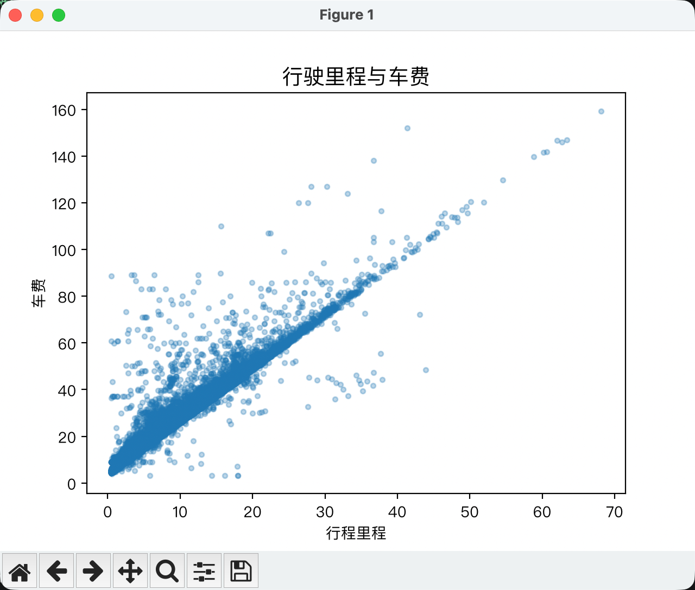
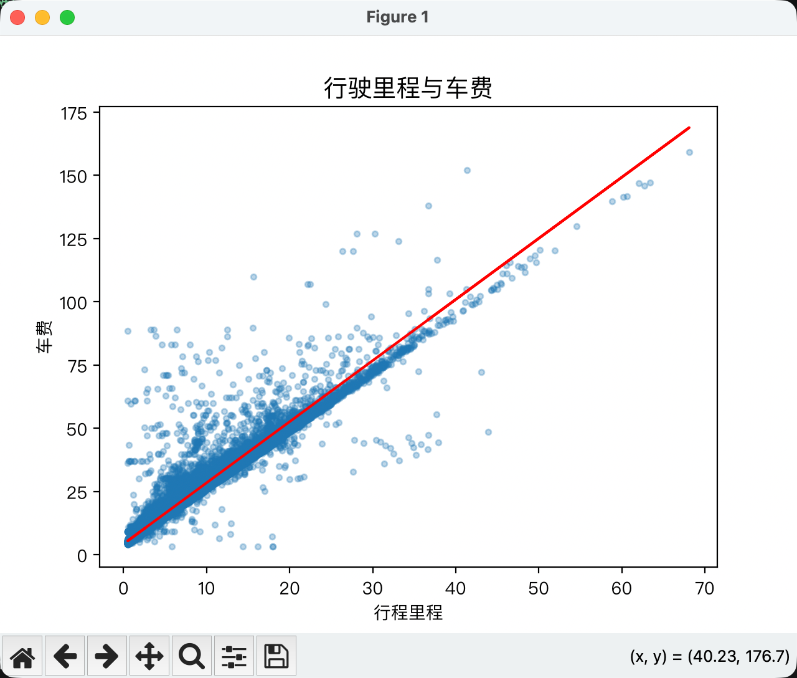

线性回归是一种用于查找变量之间关系的统计技术。在机器学习背景下，线性回归用于查找特征与标签之间的关系。

以下这个例子是用行驶里程预测芝加哥出租车费 数据来自 [芝加哥市出租车行程数据集](https://www.google.com/url?q=https%3A%2F%2Fdata.cityofchicago.org%2FTransportation%2FTaxi-Trips%2Fwrvz-psew) 


| - - - - - - - - 行驶里程（英里） - - - - - - - - | - - - - - - - - 车费 - - - - - - - - |
| ---- | --- |
|  2.57    |  31.99   |
|    1.18  |     9.75 |
| 1.29     |  10.25   |
| 3.7      |  23.75   |
| 1.15     |  10      |
| 1.38     |  11      |
| 2        | 14.5     |
|...       |...       |

我们把这些数据读取并绘制在图表上
```python
import os
# 本机 OpenMP 重复加载问题的临时绕过设置，并未消除底层运行库冲突
os.environ["KMP_DUPLICATE_LIB_OK"] = "TRUE"

import torch
import pandas as pd
import matplotlib.pyplot as plt

chicago_taxi_dataset = pd.read_csv("https://download.mlcc.google.com/mledu-datasets/chicago_taxi_train.csv")

# TRIP_MILES  行程里程
# TRIP_SECONDS 行程时长（秒）
# FARE 票价
# COMPANY  公司
# PAYMENT_TYPE  支付方式
# TIP_RATE 小费
_training_df:pd.Series | pd.DataFrame = chicago_taxi_dataset.loc[
    :, ('TRIP_MILES', 'TRIP_SECONDS', 'FARE', 'COMPANY', 'PAYMENT_TYPE', 'TIP_RATE')]

# 把 Pandas 数据转换成 PyTorch 的 Tensor（张量）。
# 输入特征 X：行程里程
_x:torch.Tensor = torch.tensor(_training_df[['TRIP_MILES']].values, dtype=torch.float)
# 真实标签 y：车费
_y:torch.Tensor = torch.tensor(_training_df[['FARE']].values, dtype=torch.float)

 # 按顺序查找可用字体，兼容 macOS 和 Windows
plt.rcParams["font.sans-serif"] = [
    "Microsoft YaHei",  # Windows：微软雅黑
    "PingFang SC",      # macOS：苹方
    "Heiti SC",         # macOS：黑体
    "SimHei",          # Windows：黑体
    "DejaVu Sans",
]

# 避免部分中文字体无法显示负号
plt.rcParams["axes.unicode_minus"] = False
    # 配置图像
plt.title("行驶里程与车费", fontsize=14)  # 设置图像名称
plt.xlabel("行程里程")  # 设置横坐标的名称
plt.ylabel("车费")  # 设置纵坐标的名称


plt.scatter(_x, _y, s=10, alpha=0.3)
plt.show()
```


从散点图可以看出，行驶里程越远，车费总体上越高，两者呈现明显的正相关关系。虽然部分数据点偏离了整体趋势，这里仍仅使用行驶里程作为输入特征，学习它与车费之间的线性关系。

为了拟合行驶里程与车费之间的关系，我们希望找到一条能够反映数据整体趋势、使预测误差尽可能小的直线：


直线可以用公式 车费 = 权重 × 行驶里程 + 偏置 表示。但我们还不知道权重和偏置应该是多少，因此需要创建一个线性回归模型来表示这个关系，再通过训练从数据中学习这两个参数。

这里使用行驶里程预测车费，所以模型只有 1 个输入特征和 1 个输出值：
```Python
import torch
model = torch.nn.Linear(in_features=1, out_features=1)
```

#### 损失函数
在训练过程中，怎么判断这条线拟合得好不好？

我们可以使用损失函数，用一个数值衡量预测车费与真实车费之间的差距。损失越小，说明模型在这个指标下拟合得越好。

线性回归中常见的损失和误差指标包括：`L1 loss`、`平均绝对误差（MAE`）、`L2 loss、均方误差（MSE）`和`均方根误差（RMSE)`。

这里使用 `L1 loss`，将预测车费与真实车费之差的绝对值相加：

```python
# L1 loss：绝对误差之和
loss_fn = torch.nn.L1Loss(reduction="sum")
```

#### 梯度下降法
有了损失函数，我们就能衡量模型的预测效果。但怎样调整权重和偏置，才能让损失减小呢？

梯度下降是一种通过反复调整模型参数，寻找较小损失的方法。梯度指向损失增大最快的方向，因此我们沿着梯度的反方向，小步更新参数。学习率控制每次更新的步幅。

模型先初始化权重和偏置，再重复以下步骤：
1. 使用当前权重和偏置计算预测值，并计算损失。
2. 计算损失对权重和偏置的梯度。
3. 根据梯度和学习率，沿着降低损失的方向更新参数。
4. 重复以上过程，直到达到设定的训练轮数，或满足提前停止条件。

#### 超参数
超参数是控制训练各个方面的变量。三个常见的超参数是：
- Learning rate  学习率
- Batch size  批量大小
- Epochs  训练轮数
```python
# 训练轮数
epochs = 20
# 批量大小
batch_size = 50
# 学习率
learning_rate = 0.001
```
#### Learning rate  学习率
**学习率（Learning rate）** 是控制每次参数更新步幅的超参数，会影响模型的收敛速度和训练稳定性。学习率太小，参数更新缓慢，可能需要更长时间才能收敛；学习率太大，可能反复越过损失较小的位置，导致损失震荡，甚至发散。选择合适的学习率，有助于模型更快、更稳定地降低损失。

#### Batch size  批量大小
批量大小（Batch size）指的是每次更新模型参数时使用的数据量。例如，批量大小为 50，就是每次用 50 个样本计算损失和梯度，然后更新一次权重和偏置。

每次更新参数，不一定要用全部训练数据来计算梯度。我们可以随机使用一个样本，或者一小批样本来估计整体梯度，这分别对应`随机梯度下降法 (SGD) `和`小批量随机梯度下降`

#### 随机梯度下降法 (SGD) 
随机梯度下降法 (SGD)  在 PyTorch 和 Keras 中，SGD 都是优化器的名称，负责根据梯度更新参数。
```python
optimizer = torch.optim.SGD(model.parameters(), lr=learning_rate)
```

#### Epochs  训练轮数
训练通常需要很多轮。也就是说，系统需要多次处理训练集中的每个样本。

#### 准备训练数据
训练之前，需要先准备数据。下面将行驶里程和车费转换成 PyTorch 使用的数据格式，再把它们配对，按批次提供给模型。
```python
import torch
from torch.utils.data import TensorDataset, DataLoader
# 把 Pandas 数据转换成 PyTorch 的 Tensor（张量）。
# 输入特征 X：行程里程
x:torch.Tensor = torch.tensor(training_df[['TRIP_MILES']].values, dtype=torch.float)
# 真实标签 y：车费
y:torch.Tensor = torch.tensor(training_df[['FARE']].values, dtype=torch.float)

# 训练数据集
dataset = TensorDataset(x, y)

# 创建数据加载器
# 假设你有 200 条训练数据，而模型每次只需要处理 50 条。
# DataLoader 就可以把数据分成 4 个 Batch（批次），让训练循环依次获取。
train_load = DataLoader(
    dataset,
    batch_size=batch_size,
    shuffle=True
    )
```


#### 前面介绍了梯度下降的原理，下面使用 PyTorch 展示模型如何按批次更新权重和偏置，并在每轮训练结束后计算训练集的平均损失。
```python
for epoch in range(epochs):
    model.train()

    for batch_x, batch_y in train_load:
        # 1. 前向传播
        prediction = model(batch_x)
        # 2. 计算 Loss
        loss = loss_fn(prediction, batch_y)

        # 3. 清空梯度
        optimizer.zero_grad()

        # 4. 反向传播
        loss.backward()

        # 5. 更新参数
        optimizer.step()
    
    # 把模型切换到评估模式（Evaluation Mode）。
    model.eval()

    # 关闭梯度记录
    with torch.no_grad():
        epoch_loss = 0

        for eval_x, eval_y in train_load:
            # 本例暂不划分数据集，直接计算模型在训练集上的平均损失
            predictions = model(eval_x)

            batch_loss = loss_fn(predictions, eval_y)
            epoch_loss += batch_loss.item()

        # 循环结束后，计算每个样本的平均损失
        epoch_loss = epoch_loss / len(train_load.dataset)
        print(f"epoch: {epoch+1}/{epochs}, loss: {epoch_loss:.4f}")

```
这里使用 `L1Loss(reduction="sum")`，损失函数已经计算了当前批次中所有样本的绝对误差之和。因此，每轮训练结束后，只需要重新计算并累加各批次的损失，再除以训练集的总样本数，就能得到当前模型在训练集上的平均绝对误差（MAE）。


## 完整示例

下面将数据读取、模型创建、训练和拟合线绘制组合起来。运行代码后，可以看到每轮训练的平均损失，以及最终的拟合直线。
```python
# 本例在 Python 3.13 环境下测试，使用 PyTorch 进行模型训练，pandas 读取数据，Matplotlib 绘制图表。
import os
# 本机 OpenMP 重复加载问题的临时绕过设置，并未消除底层运行库冲突
os.environ["KMP_DUPLICATE_LIB_OK"] = "TRUE"

import torch
import pandas as pd
import matplotlib.pyplot as plt
from torch.utils.data import TensorDataset, DataLoader

# 随机种子， 42 是“生命、宇宙以及一切的终极答案”。
torch.manual_seed(42)

# 超参数
# 训练轮数
epochs = 20
# 批量大小
batch_size = 50
# 学习率
learning_rate = 0.001

# 读取数据集
chicago_taxi_dataset = pd.read_csv("https://download.mlcc.google.com/mledu-datasets/chicago_taxi_train.csv")

# TRIP_MILES  行程里程
# TRIP_SECONDS 行程时长（秒）
# FARE 票价
# COMPANY  公司
# PAYMENT_TYPE  支付方式
# TIP_RATE 小费
training_df:pd.Series | pd.DataFrame = chicago_taxi_dataset.loc[
    :, ('TRIP_MILES', 'TRIP_SECONDS', 'FARE', 'COMPANY', 'PAYMENT_TYPE', 'TIP_RATE')]

# 把 Pandas 数据转换成 PyTorch 的 Tensor（张量）。
# 输入特征 X：行程里程
x:torch.Tensor = torch.tensor(training_df[['TRIP_MILES']].values, dtype=torch.float)
# 真实标签 y：车费
y:torch.Tensor = torch.tensor(training_df[['FARE']].values, dtype=torch.float)

# 训练数据集
dataset = TensorDataset(x, y)
# 创建数据加载器
# 假设你有 200 条训练数据，而模型每次只需要处理 50 条。
# DataLoader 就可以把数据分成 4 个 Batch（批次），让训练循环依次获取。
train_load = DataLoader(
    dataset,
    batch_size=batch_size,
    shuffle=True
    )

# 损失函数
# L1 loss：绝对误差之和
loss_fn = torch.nn.L1Loss(reduction="sum")

# 创建模型
model = torch.nn.Linear(in_features=1, out_features=1)

# 优化器
optimizer = torch.optim.SGD(model.parameters(), lr=learning_rate)

for epoch in range(epochs):
    model.train()

    for batch_x, batch_y in train_load:
        # 1. 前向传播
        prediction = model(batch_x)
        # 2. 计算 Loss
        loss = loss_fn(prediction, batch_y)

        # 3. 清空梯度
        optimizer.zero_grad()

        # 4. 反向传播
        loss.backward()

        # 5. 更新参数
        optimizer.step()

        # 把模型切换到评估模式（Evaluation Mode）。
    model.eval()

    # 关闭梯度记录
    with torch.no_grad():

        epoch_loss = 0
        
        for eval_x, eval_y in train_load:
            # 本例暂不划分数据集，直接计算模型在训练集上的平均损失
            predictions = model(eval_x)

            batch_loss = loss_fn(predictions, eval_y)
            epoch_loss += batch_loss.item()

        # 循环结束后，计算每个样本的平均损失
        epoch_loss = epoch_loss / len(train_load.dataset)
        print(f"epoch: {epoch+1}/{epochs}, loss: {epoch_loss:.4f}")

w = model.weight.item()
b = model.bias.item()

#  下面是线性回归计算， y=b+wx
y_pre = b + w * x

# 按顺序查找可用字体，兼容 macOS 和 Windows
plt.rcParams["font.sans-serif"] = [
    "Microsoft YaHei",  # Windows：微软雅黑
    "PingFang SC",      # macOS：苹方
    "Heiti SC",         # macOS：黑体
    "SimHei",          # Windows：黑体
    "DejaVu Sans",
]

# 避免部分中文字体无法显示负号
plt.rcParams["axes.unicode_minus"] = False
    # 配置图像
plt.title("行驶里程与车费", fontsize=14)  # 设置图像名称
plt.xlabel("行程里程")  # 设置横坐标的名称
plt.ylabel("车费")  # 设置纵坐标的名称


plt.plot(x, y_pre, color="red")
plt.scatter(x, y, s=10, alpha=0.3)
plt.show()

```

模型已经学习到了行驶里程与车费之间的整体关系，但部分样本的预测仍存在较大误差。


