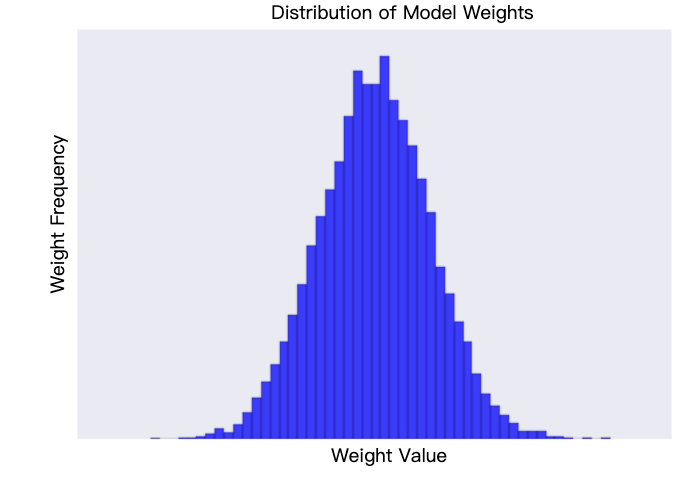
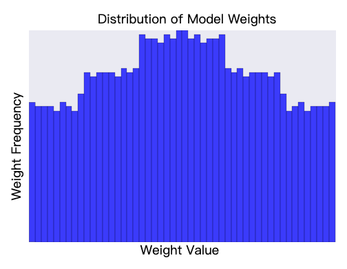
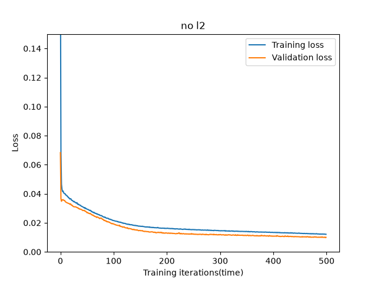
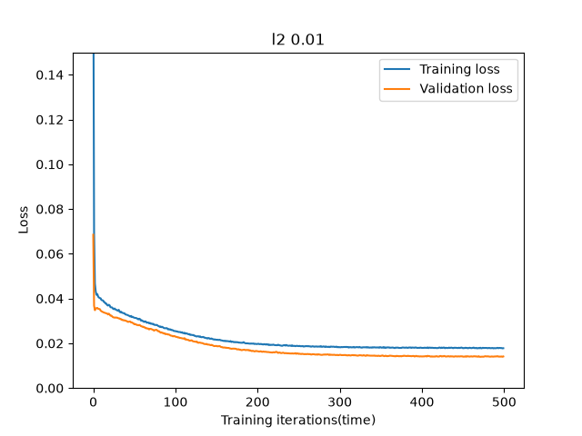
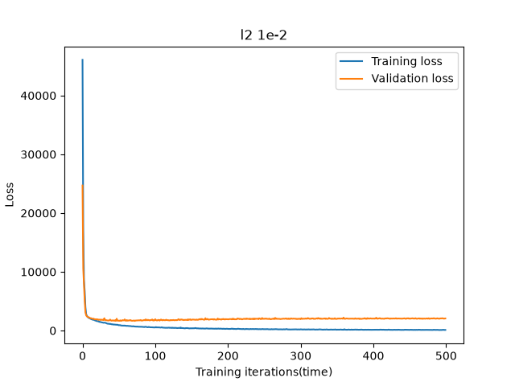
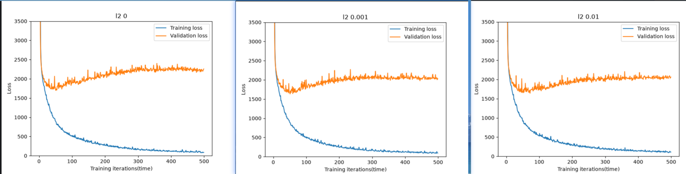
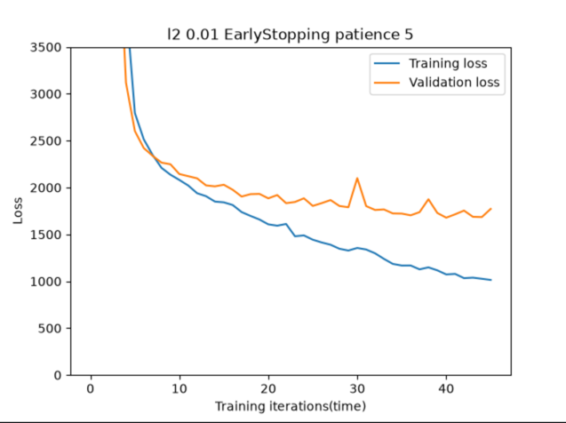
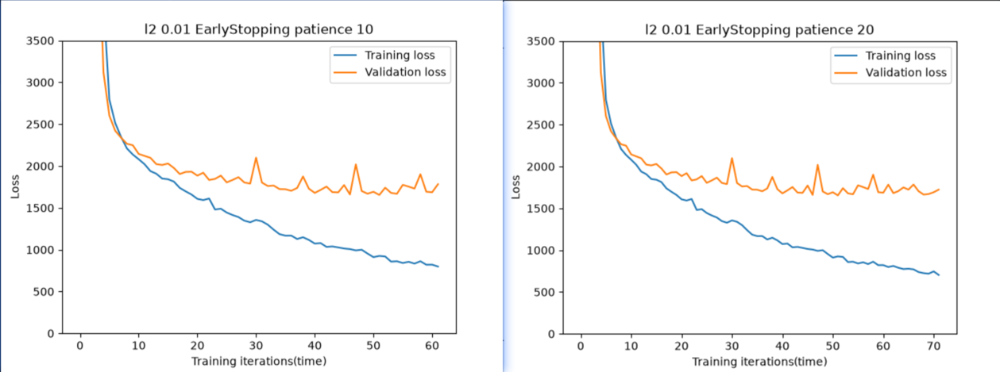

# 过拟合-L2 正则化
L 2 正则化是一种常用的正则化度量，其使用以下公式：
$$
L_2 regularization = w_1^2 + w_2^2 + ... +w_n^2
$$

| 权重 | Value 值 | Squared value 平方值 |
|---|---:|---:|
| w₁ | 0.2 | 0.04 |
| w₂ | -0.5 | 0.25 |
| w₃ | 5.0 | 25.0 |
| w₄ | -1.2 | 1.44 |
| w₅ | 0.3 | 0.09 |
| w₆ | -0.1 | 0.01 |
| **总计 Total** | | **26.83** |

L 2 正则化对小的权重值影响不大， 会惩罚比较大的权重值， 也就是它有助于降低模型复杂度， L2 正则化不是直接修改权重，而是在损失函数中增加惩罚项，让优化器在训练时倾向于选择较小的权重。

## 正则化率（lambda）
>这个lambda和python的匿名函数不是一个东西， 我第一次看还有点迷糊

$$
minimize(loss + complexity)
$$
其中：
- Loss：模型的预测误差。
- Complexity：模型复杂度惩罚。

模型开发者通过将复杂度的值乘以一个称为正则化率的标量，来调节复杂度对模型训练的整体影响。希腊字母 λ 通常用来表示正则化率。
$$
\min(\text{Loss} + \lambda \cdot \text{Complexity})
$$

增大正则化率 λ：增强正则化的作用，从而降低过拟合的风险。
减小正则化率 λ：减弱正则化的作用，从而增加过拟合的风险。


示意图中高正则化率下的权重直方图。均值为零。正态分布。


低正则化率下的权重直方图。均值可能为零，也可能不为零。

>将正则化率设为零会完全移除正则化。在这种情况下，训练只专注于最小化损失，这会带来最高的过拟合风险。

# 选择正则化率
理想的正则化率会产生一个能很好地泛化到新的、先前未见数据的模型。遗憾的是，该理想值取决于数据，因此你必须进行一些调优。

## 早停法：基于复杂度正则化的替代方案
提前停止是一种不涉及复杂度计算的正则化方法。相反，提前停止仅仅意味着在模型完全收敛之前结束训练。例如，当验证集的损失曲线开始上升（斜率变为正值）时，你就结束训练。

尽管提前停止通常会增加训练损失，但它可以降低测试损失。

提前停止是一种快速但很少能达到最优效果的正则化形式。由此得到的模型，很可能不如在理想正则化率下经过充分训练的模型。

## 在学习率与正则化率之间寻找平衡
> 在学习率与正则化率之间寻找平衡， 这是炼丹吗? 那llm甚至还有vibecoding都是炼丹吗？只是炼的东西不一样。

学习率与正则化率往往会使权重朝相反方向变动。较高的学习率通常会将权重拉离零；较高的正则化率则会将权重推向零。

如果正则化率相对于学习率较高，较弱的权重往往会产生一个预测效果不佳的模型。反之，如果学习率相对于正则化率较高，较强的权重往往会产生一个过拟合的模型。

你的目标是找到学习率与正则化率之间的平衡点。这可能颇具挑战。最糟糕的是，一旦你找到了那个难以把握的平衡，你可能最终又不得不改变学习率。而当你改变学习率时，你又得重新寻找理想的正则化率。

----
# 代码部分
数据集依旧是 GPT老师提供
[混凝土抗压强度](https://archive.ics.uci.edu/dataset/165/concrete-compressive-strength)

[pytorch实现L2和L1正则化](https://blog.csdn.net/guyuealian/article/details/88426648)

### pytorch实现L2正则化
PyTorch 的 SGD、Adam 等优化器提供了 weight_decay 参数。
>weight_decay（浮点数，可选参数）——权重衰减（L2 惩罚），默认值为 0。

但 weight_decay 不能直接实现 L1 正则化。如果需要使用 L1 正则化，可以手动计算 L1 惩罚项，并将其加入损失函数。
>在 PyTorch 的 SGD 优化器中，weight_decay 是权重衰减系数，用于控制 L2 正则化的强度，可以将其理解为正则化率 λ，但需要注意不同公式的系数约定。
python代码：
```python
torch.optim.SGD(_model.parameters(), lr=_learning_rate, weight_decay=0.01)
```
我用混凝土抗压强度数据集训练了一个模型， 用8个输入特征。不用L2正则化， 通过绘制训练损失和验证损失得到以下结果

看起来这个模型拟合的非常不错， 训练损失和验证损失没有分开

似乎没有正则化的必要， 但我还是想试试， 不然我代码白写了

可以看到训练损失和验证损失均明显增加了， 结果并不好， L2 正则化没有改善验证集表现，反而使预测误差增大了。
由于当前模型没有明显的过拟合，而 PyTorch SGD 的 weight_decay 默认会对权重和偏置都施加惩罚，因此在本次实验中，较强的正则化可能限制了模型的拟合能力，导致训练损失和验证损失都有所增加。

不过我还有一个之前明显过拟合的模型
[onehot_train.py](../%E7%B1%BB%E5%88%AB%E6%95%B0%E6%8D%AE%E5%A4%84%E7%90%86-%E7%8B%AC%E7%83%AD%E7%BC%96%E7%A0%81/onehot_train.py)
这个试验是学习处理独热编码的， 怀疑是过拟合， 但是当时没有处理过拟合的问题
现在我把他复制出来尝试用用L2正则化进一步处理
[bike_l2.py](bike_l2.py)
下面是之前的损失曲线


可以看到， 即使原本设置了 0.01的weight_decay， 模型还是出现了过拟合, 但不能说吗 l2没有效果， 还需要多几个参数的实验来证明
下面是用三组weight_decay参数进行的实验


我放大了损失曲线的范围， 并对比了三个参数的效果， 发现L2的效果还是不错的， 只是还无法解决这次训练过拟合的问题， 也许 **早停法**可以。

---
# 早停法
[Pytorch-早停法](https://blog.csdn.net/weixin_40446557/article/details/103387629)

安装并导入早停法模块
```python
# import EarlyStopping
from early_stopping_pytorch import EarlyStopping
```

早停耐心值（patience）：验证损失上一次改善后，还允许继续等待多少个训练轮次（Epoch）。
>耐心值就是“允许验证集指标连续多少轮不提升（甚至下滑），才触发早停”，

```python
patience = 5
```
[完整的代码](bike_l2_early_stop.py)
初始化  EarlyStopping
```python
# 初始化  EarlyStopping  对象
early_stopping = EarlyStopping(patience=_patience, verbose=True)
```

我的训练循环是这样的，EarlyStopping 会在验证损失达到新的最低值时，自动将当前模型的参数保存到 checkpoint.pt 文件中。

当验证损失连续多个 Epoch 没有改善，并达到设定的 patience 后，便会触发早停。

训练结束后，再从 checkpoint.pt 中加载验证损失最低时保存的模型参数，而不是停止训练前一轮的模型。
```python
for t in range(_epochs):
    print(f"Epoch {t + 1}\n-------------------------------")
    train_loss = train(
        train_load=_train_dataload,
        model=_model, optimizer=_optimizer,
        loss_fn=_loss_fn)
    _loss_on_trainings.append(train_loss)

    test_loss = test(
        test_load=_val_dataload,
        model=_model,
        loss_fn=_loss_fn)

    _loss_on_validations.append(test_loss)

    # early_stopping需要获取验证损失（ValidationLoss
    # 以检查它是否下降。如果验证损失下降，就会为当前模型创建一个检查点（Checkpoint）。
    # test_loss就是当前验证集的平均损失
    early_stopping(test_loss, _model)
    if early_stopping.early_stop:
        print("Early stopping")
        break

    print("Done!")

# 加载保存了最佳模型的最新检查点（Checkpoint）。
_model.load_state_dict(torch.load('checkpoint.pt', weights_only=True))
```
当耐心为5时训练的效果

可以看到训练在大概45左右停止了， 但是耐心为5可能有点小， 我测试了更大的耐心值， 看看模型是否有更大的改进空间
> patience is the key in life

看起来耐心值为5时， 效果更好（经过Gpt老师提醒后我才看出来， 我也许比较适合星际争霸这款游戏）
