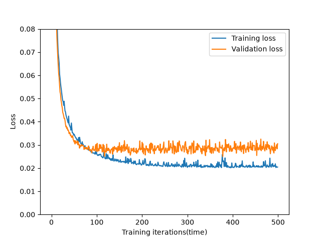
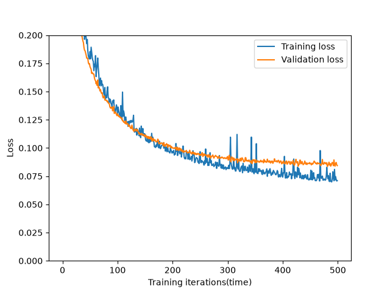

# 逻辑回归-代码练习
Sigmoid 函数可以将线性模型的输出映射到 0～1 之间，使模型能够输出概率。因此，在原有线性模型的基础上加入 Sigmoid 函数，就可以构建一个逻辑回归模型。

本次练习使用 [钞票真伪鉴定](https://archive.ics.uci.edu/dataset/267/banknote)

完整的代码在[logistic_train.py](logistic_train.py)

逻辑回归和线性回归的区别是逻辑回归多了一个Sigmoid函数， 在模型结构上，可以使用 Sequential 将线性层和 Sigmoid 组合起来，构建一个简单的逻辑回归模型。

也有另外的方式， 比如我使用 BCEWithLogitsLoss 这个损失函数， 因为 BCEWithLogitsLoss 内部结合了 Sigmoid 和 Binary Cross Entropy（交叉熵损失），所以不需要在模型中额外添加 Sigmoid，就可以直接使用线性层的输出计算损失, 这样可以在线性回归代码的基础上，复用原来的线性层，将输出作为 Logits，配合 BCEWithLogitsLoss，就可以构建一个简单的逻辑回归模型。
```python
loss_fn = torch.nn.BCEWithLogitsLoss()
```
接下来检查模型能否输出 0～1 之间的概率。由于模型本身没有添加 Sigmoid，因此预测时需要手动进行转换。
```python
_model.eval()
with torch.no_grad():
    for X, y in test_loader:
        logits = _model(X[0])

        # 使用 sigmoid 将 Logits 转换为 0~1 之间的概率
        prob = torch.sigmoid(logits)

        print(f"prob {prob[0]:.4f}  y {y[0][0]}")

```

这里展示的是测试集中的部分预测概率及对应标签，用来观察 Sigmoid 的输出
````python
prob 0.9999  y 1.0
prob 1.0000  y 1.0
prob 0.9978  y 1.0
prob 0.9816  y 1.0
prob 0.0000  y 0.0
````
可以看到，模型预测的概率与真实标签比较接近，说明模型能够区分钞票的真假。

### 补充实验

除了使用 BCEWithLogitsLoss，我还打算尝试用其他方式实现。

完整的代码在[logistic_sigmoid_train.py](logistic_sigmoid_train.py)

[PyTorch的十八个损失函数](https://zhuanlan.zhihu.com/p/61379965)
### BCELoss
```python
loss_fn = torch.nn.BCELoss()
```

由于 BCELoss 不会在内部执行 Sigmoid，因此需要修改模型，在输出层添加 Sigmoid，将模型输出的 logits 转换为 0～1 之间的概率，再传入损失函数计算。
```python
class LogisticRegression(torch.nn.Module):
    def __init__(self, *args: Any, **kwargs: Any):
        super().__init__(*args, **kwargs)

        self.network = torch.nn.Sequential(
            torch.nn.Linear(in_features=4, out_features=1),
            torch.nn.Sigmoid()
        )

    def forward(self, x):
        # 前向传播
        return self.network(x)
```

训练效果还行

### CrossEntropyLoss 是 PyTorch 中用于多分类的损失函数。它结合了 nn.LogSoftmax 和 nn.NLLLoss，常用于图像分类、文本分类等任务。我这次是二分类， 他可以用

```python
loss_fn = torch.nn.CrossEntropyLoss()
```

完整代码 ：[logistic_cross_entropy_train.py](logistic_cross_entropy_train.py)

这里模型也要调整
```python
class LogisticRegression(torch.nn.Module):
    def __init__(self, *args: Any, **kwargs: Any):
        super().__init__(*args, **kwargs)

        self.network = torch.nn.Sequential(
            torch.nn.Linear(in_features=4, out_features=2),
        )

    def forward(self, x):
        # 前向传播
        return self.network(x)
```
输入标签也要修改， CrossEntropyLoss要求目标数据类型必须为 long
```python
y_train_tensor = torch.tensor(y_train["class"].values, dtype=torch.long)
```
有必要了解一下这里的Softmax和LogSoftmax， 不然代码看不懂。

Softmax 是一种将模型输出的原始分数（Logits）转换为概率分布的函数。

它有两个特点：
   1. 每个输出值都在 0～1 之间。
   2. 所有输出值相加等于 1

原始分数（logits）指的是深度学习模型最后一层输出的“未归一化分数”，它是任意实数向量，用于在经过 Softmax 或 Sigmoid 后转换成概率。

我这里让他输出了两个， 所以他预测也会得到两个结果， 第一个是假钞的概率， 第二个是真钞的概率， google在介绍多分类时拿梨来举例， 分别用， 是苹果概率是多少， 是橘子的概率是多少， 是梨的概率是多少， 是葡萄的概率是多少，他是输出4个结果的多分类， 那我这里就是输出两个结果的多分类
```
prob 0.0000 1.0000
```

LogSoftmax 就是先计算 Softmax，然后对结果取自然对数。
自然对数（Natural Logarithm） 是以一个特殊的数学常数 \(e\) 为底数的对数。

最后训练sklearn内置的乳腺癌数据集
完整的代码在[breast_cancer_train.py](breast_cancer_train.py)

他有30个输入， 输入需要归一化

看结果还不错
