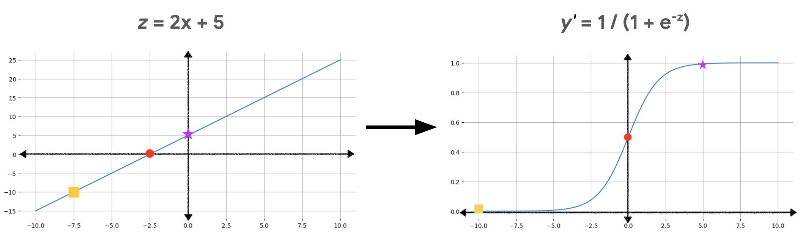

# 逻辑回归
如何预测`今天会下雨吗？`, `我的车需要换变速箱吗？`, `这封电子邮件是垃圾邮件吗？`这种问题呢？
我们来仔细看一下最后一个问题。

您想要开发一个过滤器， 用来预测一封电子邮件是真实邮件还是垃圾邮件。

然后您收集训练数据和测试数据， 并训练一个线性回归模型，其中1表示预测为垃圾邮件， 0表示预测为真实邮件。

依据是电子邮件文本中垃圾邮件特征的数量。

假设一封电子邮件包含10个垃圾邮件词语

它是垃圾邮件吗？

值为 1 时表示 垃圾邮件， 值为0时表示非垃圾邮件。

那么值为 0.62 意味着什么？

该值是概率的一个指标，表示它是垃圾邮件的可能性， 较低的值表示较低的垃圾邮件概率， 而较高的值则表示较高的垃圾邮件概率。

但更有意义的做法是， 让一个回归模型， 以形式化的方式， 即用值 0 或 1， 给出某封邮件为垃圾邮件的概率。这类回归任务称为逻辑回归。

一个线性模型如何能输出概率？

您必须修改模型并应用边界， 使其输出连续值， 这些值位于 0到1的范围内。

这里 0 表示垃圾邮件概率为 0%， 而1表示垃圾邮件概率为100%。

哪种数学函数可以表示这一点？

Logistic函数， 它是一条S曲线， 其输出值介于0和1之间。当输入趋近于负无穷时， 输出趋近于0。而当输入趋近于正无穷时， 输出趋近于1。这是一种所谓的Sigmoid函数， 也叫 **S型函数。**

一个S型曲线， 也称为逻辑函数。
它赋予了逻辑回归其名称，借助它， 您可以将线性模型的输出映射为连续的概率。

当您重新训练模型时， 您可以针对任意数量的垃圾邮件词语计算垃圾邮件概率， 通过逻辑回归， 您可以包含10个垃圾邮件词的电子邮件， 预测出69%的垃圾邮件概率。

在实践中， 您会训练一个垃圾邮件预测模型， 使用更多特征并应用精细的语言处理， 逻辑回归非常适用于区分两种可能结果的模型，

# 使用 S 型函数计算概率
许多问题需要概率估计作为输出。逻辑回归是一种极其高效的概率计算机制。实际上，你可以通过以下两种方式之一使用返回的概率：
- “按原样”应用。例如，如果一个垃圾邮件预测模型将一封电子邮件作为输入，并输出值 0.932 ，这意味着该电子邮件是垃圾邮件的概率为 93.2% 。
- 转换为二元类别，例如 True 或 False ， Spam 或 Not Spam 。

Sigmoid S 型函数

您可能想知道，逻辑回归模型如何确保其输出代表一个概率，始终输出一个介于 0 和 1 之间的值。事实上，存在一类称为逻辑函数的函数，其输出具有相同的特性。标准逻辑函数，也称为 sigmoid 函数（sigmoid 意为“S 形”），其公式为：
$$
f(x) = \frac{1}{1+e^-x}
$$

其中：
- f(x) 是 sigmoid 函数的输出。
- e 是欧拉数：一个数学常数 ≈ 2.71828。
- x 是 sigmoid 函数的输入。

图：当 x 值减小到负无穷时，曲线趋近于 0；当 x 值增大到正无穷时，曲线趋近于 1。

随着输入 x 的增加，sigmoid 函数的输出趋近于但永远不会达到 1 。类似地，随着输入的减小，sigmoid 函数的输出趋近于但永远不会达到 0 。

以下方程表示逻辑回归模型的线性分量：
$$
z = b + w_1x_1 + w_2x_2 + ... + w_nx_n
$$

where:  其中：
- z 是线性方程的输出，也称为对数几率。
- b 是偏置。
- w 值是模型学习到的权重。
- x 值是特定样本的特征值。

为了获得逻辑回归预测，z 值随后被传入 sigmoid 函数，产生一个介于 0 和 1 之间的值（概率）：
$$
y' = \frac{1}{1+e^-z}
$$
其中：
- y' 是逻辑回归模型的输出。
- e 是欧拉数：一个数学常数 ≈ 2.71828。
- z 是线性输出（按前述公式计算得出）。

线性函数 z = 2x + 5 的图形，其中高亮了三个点。右图：经过 sigmoid 函数变换后，高亮了相同三个点的 Sigmoid 曲线。

线性方程成为 sigmoid 函数的输入，该函数将直线弯曲成 S 形。请注意，线性方程可以输出非常大或非常小的 z 值，但 sigmoid 函数的输出 y' 始终在 0 和 1 之间（不包括端点）。例如，左图中黄色方块的 z 值为 –10，但右图中的 sigmoid 函数将该 –10 映射为 y' 值 0.00004。

## 损失与正则化
逻辑回归模型的训练过程与线性回归模型相同，但有两个关键区别：
- 逻辑回归模型使用对数损失（Log Loss）作为损失函数，而不是平方损失（Squared Loss）。
- 应用正则化对于防止过拟合至关重要。

## Log Loss  对数损失
在线性回归模块中，您使用平方损失（也称为 $L_2$ 损失）损失函数.平方损失适用于输出值变化率为常数的线性模型。例如，给定线性模型 $y' = b + 3x_1$, 每次将输入值 $x_1$ 增加1，输出值 $y'$ 就会增加 3。

然而，逻辑回归模型的变化率并非恒定。S 形曲线呈 S 形而非线性。当对数几率( $z$ )值更接近 0 时，$z$ 的微小增加会导致 $y$ 发生比 $z$ 为大正数或大负数时大得多的变化。下表显示了 S 形函数在输入值为 5 到 10 时的输出，以及捕捉结果差异所需的相应精度。

| input 输入 | logistic output 逻辑输出 | required digits of precision 所需精度位数 |
|---:|---:|---:|
| 5 | 0.993 | 3 |
| 6 | 0.997 | 3 |
| 7 | 0.999 | 3 |
| 8 | 0.9997 | 4 |
| 9 | 0.9999 | 4 |
| 10 | 0.99998 | 5 |

如果使用平方损失来计算 Sigmoid 函数的误差，那么随着输出越来越接近 0 和 1，你就需要更多的存储空间，才能保留足够的数值精度来准确表示这些值。

相反，逻辑回归使用对数损失（Log Loss）作为损失函数。对数损失计算的是误差幅度的对数，而不仅仅是数据真实值与预测值之间的距离。其计算方式如下：

$$
LogLoss=-\frac{1}{N}\sum_{i=1}^{N}
\left[
y_i\log(y'_i)+(1-y_i)\log(1-y'_i)
\right]
$$

其中:
- $N$ 是数据集中已标记示例的数量
- $i$ 是数据集中某个示例的索引
- （例如， $（x_3, y_3）$ 是数据集中的第三个示例）
- $y_i$ 是第 $i$ 个示例的标签。 由于这是逻辑回归， $y_i$ 必须为0或1。
- $y'_i$ 是模型在给定 $x_i$ 中的特征集时， 对第 $i$ 个示例的预测值 (介于 0 和 1之间)。

# 逻辑回归中的正则化
[过拟合-L2 正则化](../%E8%BF%87%E6%8B%9F%E5%90%88-L2%20%E6%AD%A3%E5%88%99%E5%8C%96/README.md)
-  L 2 正则化（L2 regularization）
- 早停法（Early stopping）：限制训练步数，在损失仍在下降时停止训练。
