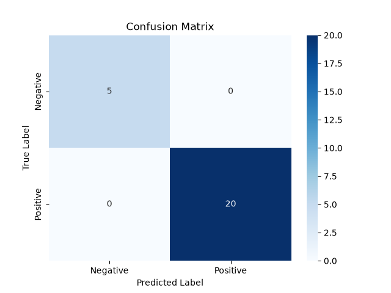

[混淆矩阵（Confusion Matrix）详解](https://zhuanlan.zhihu.com/p/681998308)

**阈值**就是用了处理逻辑回归结果的， 用来决定0.6是垃圾邮件还是正常邮件

在训练中使用阈值可以这样
```python
# 阈值
_threshold = 0.5
pred = torch.where(prob > _threshold, 1, 0)
```
完整代码在[breast_cancer_threshold_train.py](breast_cancer_threshold_train.py)

## 混淆矩阵
概率分数并不是现实，也不是真实情况。对于二元分类器的每个输出，都有四种可能的结果。以垃圾邮件分类器为例，如果将真实情况作为列，将模型的预测作为行，就会得到下面这张表，称为混淆矩阵
|  | Actual positive（实际为正类） | Actual negative（实际为负类） |
|---|---|---|
| **Predicted positive（预测为正类）** | **True positive（TP，真正例）**：垃圾邮件正确分类为垃圾邮件。 | **False positive（FP，假正例）**：正常邮件错误分类为垃圾邮件。 |
| **Predicted negative（预测为负类）** | **False negative（FN，假负例）**：垃圾邮件错误分类为正常邮件。 | **True negative（TN，真负例）**：正常邮件正确分类为正常邮件。 |

通过设定一个阈值，我们可以决定如何将模型的预测结果划分为正类和负类。

由于不同类别的样本数量可能存在差异，直接使用 0.5 作为阈值，在某些情况下可能会产生较多的假正例（FP）或假负例（FN）。

因此，我们可以结合混淆矩阵观察不同阈值下的分类结果，并根据实际需求调整阈值，在误报和漏报之间找到合适的平衡。

混淆矩阵是用于评估逻辑回归等分类模型预测结果的工具。通过观察不同阈值下的混淆矩阵，可以了解模型的误报和漏报情况，并根据实际需求调整分类阈值。 使用PyTorch实现混淆矩阵
```python
from torchmetrics.classification import BinaryConfusionMatrix
confusion_matrix = BinaryConfusionMatrix(threshold=0.5)
result = confusion_matrix(predictions, y)
print(result)

# tensor([[11,  0],
#         [ 1, 20]])
# tensor([[ 5,  0],
#         [ 0, 20]])
```
用seaborn库可视化
```python
import matplotlib.pyplot as plt
# 安装seaborn库
import seaborn as sns
matrix = result.cpu().numpy()
sns.heatmap(
    matrix,
    annot=True,
    fmt="d",
    cmap="Blues",
    xticklabels=["Negative", "Positive"],
    yticklabels=["Negative", "Positive"]
)

plt.xlabel("Predicted Label")
plt.ylabel("True Label")
plt.title("Confusion Matrix")
plt.show()
```
